# Parts list (working copy)

Your decisions on every part I suggested. **Edit this file** (on GitHub: open it → ✏️ → *Commit changes*); everything else follows: `bom.csv`, budget, checklists (`make`, or the *parts-sync* action on GitHub within a minute).

**How to edit a line**

- Tick `[x]` = you agree; untick = back to `suggested`.
- Or change the word after `status:` to one of: `suggested` · `agreed` · `ordered` · `have` · `swap` (you want another part: say which in `note:`) · `skip` (not using it). For printed parts, `have` = printed.
- `paid:` what you really paid, shipping included (e.g. `paid: 27.40`). `note:` anything.
- Only the `- [ ]` line, `note:` and `paid:` are read; the picture, *Must meet* and *why* lines are rewritten each time. New parts: `python tools/new.py part …`.
- **Must meet** = what any substitute has to match (rating, size, focal length, …), so you can buy elsewhere safely. Pictures are drawings of the kind of part; the buy link shows the real product.

<!-- parts-summary -->
| Status | Parts | Core USD | Optional USD | Tools USD |
|---|---:|---:|---:|---:|
| suggested | 77 | $440.85 | $436.25 | $469.76 |
| agreed | 0 | $0.00 | $0.00 | $0.00 |
| ordered | 8 | $70.75 | $0.00 | $0.00 |
| have | 0 | $0.00 | $0.00 | $0.00 |
| swap | 0 | $0.00 | $0.00 | $0.00 |
| skip | 0 | $0.00 | $0.00 | $0.00 |
| **Still to buy** | 52 | **$440.85** | **$0.00** | **$469.76** |
| Paid so far | | $0.00 | | |
| Plan: every core part bought (cap $630) | | $511.60 | | |

Still to buy = core parts not `ordered` / `have` / `swap` / `skip`, plus optional parts you `agreed` to. Tools are bought once and kept: they have their own total and are not in the machine cap.

## 00 · Plan

0/12 decided · still to buy $63.96 · [bom.csv](phases/00-plan/bom.csv) · [checklist](phases/00-plan/README.md)

- [ ] **TLS-01** Enclosed FDM 3D printer for ABS (Elegoo Centauri 2) — 1 × $279.00 = $279.00 · tool · [buy at amazon.com](https://www.amazon.com/dp/B0GZYZY956) · status: suggested
  -  **Qty 1** · **Must meet:** Enclosed FDM printer, hot end ≥ 260 °C, heated bed ≥ 100 °C, build volume ≥ 220 × 220 × 200 mm (the tilt yoke is 175 mm tall)
  - *why:* Every printed part (ABS needs an enclosure: no warping, steady chamber heat) · Enclosed CoreXY, 350 °C nozzle, 256 mm cube. The Centauri Carbon listing (B0FDQP54X8) only had used units. Check the bed reaches 100 °C for ABS.
  - note:
  - paid:
- [ ] **TLS-02** Screwdriver set (Phillips #1/#2 + flat 2–3 mm) — 1 × $9.99 = $9.99 · tool · [buy at amazon.com](https://www.amazon.com/dp/B07RFD9JWZ) · status: suggested
  -  **Qty 1** · **Must meet:** Phillips #1/#2 (e-stop, switch), flat 2–3 mm (screw terminals)
  - *why:* Terminal screws, lever connectors
  - note:
  - paid:
- [ ] **TLS-03** Hex keys 1.5 / 2 / 2.5 / 3 / 4 mm — 1 × $9.99 = $9.99 · tool · [buy at amazon.com](https://www.amazon.com/dp/B0CJBRYQF3) · status: suggested
  -  **Qty 1** · **Must meet:** Metric hex keys 1.5–4 mm (1.5 mm for every M2 screw; often in the FRM-06 kit)
  - *why:* M2 socket screws (1.5 mm), M3 motor screws (2.5 mm), pulley grubs
  - note:
  - paid:
- [ ] **TLS-04** Wire stripper / cutter 10–24 AWG — 1 × $10.49 = $10.49 · tool · [buy at amazon.com](https://www.amazon.com/dp/B07TS6KCXD) · status: suggested
  -  **Qty 1** · **Must meet:** Stripper for 10–24 AWG with a cutter (self-adjusting is easiest)
  - *why:* Strip 11 mm for lever connectors; cut jumpers and belt
  - note:
  - paid:
- [ ] **TLS-05** Multimeter with temperature probe — 1 × $34.99 = $34.99 · tool · [buy at amazon.com](https://www.amazon.com/dp/B071JL6LLL) · status: suggested
  -  **Qty 1** · **Must meet:** Digital multimeter: DC V, Ω, continuity beep, diode; thermocouple probe (°C)
  - *why:* Every electrical check (T1–T9) and the heat checks · Check a K-type probe is in the box.
  - note:
  - paid:
- [ ] **TLS-06** Digital calipers 150 mm — 1 × $14.59 = $14.59 · tool · [buy at amazon.com](https://www.amazon.com/dp/B0D2386QN9) · status: suggested
  -  **Qty 1** · **Must meet:** 150 mm (6 in) digital calipers, 0.01 mm display
  - *why:* Print fit, tolerance coupon, positions · Check 0.01 mm resolution on the listing.
  - note:
  - paid:
- [ ] **TLS-07** Tape measure 3 m (metric) + phone level app — 1 × $1.48 = $1.48 · tool · [buy at amazon.com](https://www.amazon.com/dp/B0BRFTX359) · status: suggested
  -  **Qty 1** · **Must meet:** Metric tape ≥ 1 m; any phone level app (replaces a bubble level and set square)
  - *why:* Camera distance, level checks
  - note:
  - paid:
- [ ] **TLS-08** Inkjet printer, US Letter, prints at 100 % — 1 × $49.99 = $49.99 · tool · [buy at amazon.com](https://www.amazon.com/dp/B0GKJZ864R) · status: suggested
  -  **Qty 1** · **Must meet:** Prints Letter paper at 100 % (Actual size); any inkjet or laser
  - *why:* Placement template, ChArUco boards, focus grid · Prints the placement template (4 tiles), ChArUco boards, focus grid and protractor. Print dialog: Actual size / 100 %; check the 100 mm bar.
  - note:
  - paid:
- [ ] **TLS-09** CA glue, double-sided tape, utility knife, 400-grit sandpaper — 1 × $29.28 = $29.28 · tool · [buy at amazon.com](https://www.amazon.com/dp/B00I4CWHD4) · status: suggested
  -  **Qty 1** · **Must meet:** Cyanoacrylate (super) glue; double-sided foam or carpet tape; snap-off utility knife with spare blades; one sheet of 400-grit wet/dry paper
  - *why:* Rim belt (M13.3), protractor scales (M12.3), labels; cut and sand the PTFE white tile (M16.3) · Four listings: https://www.amazon.com/dp/B00I4CWHD4 , https://www.amazon.com/dp/B0D8PMVRKD , https://www.amazon.com/dp/B07PNG8ZSG , https://www.amazon.com/dp/B00004Z4BE
  - note:
  - paid:
- [ ] **TLS-10** 13 mm spanner (or an adjustable wrench) — 1 × $7.00 = $7.00 · tool · [buy at amazon.com](https://www.amazon.com/dp/B00Q01OBLC) · status: suggested
  -  **Qty 1** · **Must meet:** 13 mm open/ring spanner or an adjustable wrench opening ≥ 13 mm
  - *why:* M8 nuts and bolt heads: table axle, tilt stub axles
  - note:
  - paid:
- [ ] **TLS-11** Printer paper, Letter, 500 sheets — 1 × $6.97 = $6.97 · tool · [buy at amazon.com](https://www.amazon.com/dp/B01FV0F8H8) · status: suggested
  -  **Qty 1** · **Must meet:** Plain matte white paper, 8.5 × 11 in
  - *why:* Template, ChArUco boards, focus grid · For the TLS-08 printer.
  - note:
  - paid:
- [ ] **FIL-01** ABS filament 1.75 mm, black, 1 kg (4 spools) — 4 × $15.99 = $63.96 · [buy at amazon.com](https://www.amazon.com/dp/B0DDPSXDHG) · status: suggested
  -  **Qty 4** · **Must meet:** ABS, 1.75 mm ± 0.03, black (matte if available), sealed with desiccant; ≥ 4 kg so a failed print never stops the build
  - *why:* All printed parts: core ≈ 2.7 kg with the printed deck (cad/PRINT.md) + reprints; black so nothing glints near the optics · Core prints ≈ 2.7 kg (cad/PRINT.md: the 9 deck tiles are half of it); the 4th spool covers reprints and kits.
  - note:
  - paid:

## 01 · Power

0/6 decided · still to buy $66.71 · [bom.csv](phases/01-power/bom.csv) · [checklist](phases/01-power/README.md)

- [ ] **PWR-30** 24 V 3 A wall adapter with screw-terminal DC jack — 1 × $17.85 = $17.85 · [buy at amazon.com](https://www.amazon.com/dp/B078RY7BPL) · status: suggested
  -  **Qty 1** · **Must meet:** Regulated 24 V DC, ≥ 3 A (72 W), 5.5 × 2.1 mm plug, short-circuit and overload protection, with a female 5.5 × 2.1 mm jack to screw terminals (+ / − marked): no solder
  - *why:* Power for the whole machine: plugs into the wall; its round plug goes into the screw-terminal jack · Listing (read 2026-10-23): FCC / CE / RoHS (not a UL listing); short-circuit, overload and over-temperature protection; AC cable ~120 cm, DC cable ~110 cm. The adapter stays outside the machine; only the jack sits on the power plate. Replaces the battery, USB-C charging, fuse and their box.
  - note:
  - paid:
- [ ] **PWR-28** Emergency stop in its own box, latching, 1 NO + 1 NC, screw terminals — 1 × $8.99 = $8.99 · [buy at amazon.com](https://www.amazon.com/dp/B00NTT91Y0) · status: suggested
  -  **Qty 1** · **Must meet:** Latching mushroom e-stop (push to stop, twist to release) already mounted in its own box: no panel hole; ≥ 1 normally-closed contact rated ≥ 3 A (DC rating where the listing gives one); screw terminals (no solder)
  - *why:* Cuts 24 V to the motor board (motors, lamp); also the off switch · Contacts rated 660 V / 10 A (AC). Wire the NC contact: terminals 1 and 2 on this switch, NO = 3 and 4 (confirm with the meter: 1–2 beep released, open pressed). Sits on the power plate on double-sided tape.
  - note:
  - paid:
- [ ] **PWR-10** Optocoupler module PC817, 24 V input, screw terminals (2-pack) — 1 × $6.99 = $6.99 · [buy at amazon.com](https://www.amazon.com/dp/B0B5382ZT7) · status: suggested
  -  **Qty 1** · **Must meet:** 1-channel PC817 isolation module, 24 V input version (works from 18–24 V), 3.3–5 V output side, screw terminals: no breadboard, no solder
  - *why:* Isolated motion-power sense to the ESP32-S3 hub (resistor on the board) · 66 x 16.5 x 12 mm; sits in a locating frame on the controller tray (double-sided tape). Second module spare.
  - note:
  - paid:
- [ ] **PWR-15** 18 AWG silicone wire red/black, 1.5 m (5 ft) each colour — 1 × $7.98 = $7.98 · [buy at amazon.com](https://www.amazon.com/dp/B01708AYYQ) · status: suggested
  -  **Qty 1** · **Must meet:** 18 AWG stranded silicone wire, red + black (≥ 5 A)
  - *why:* Power wiring
  - note:
  - paid:
- [ ] **PWR-20** Lever wire connectors, WAGO 221 assortment (12) — 2 × $12.45 = $24.90 · [buy at amazon.com](https://www.amazon.com/dp/B0CJ5QF4Z2) · status: suggested
  -  **Qty 2** · **Must meet:** Lever splicing connectors for 24–12 AWG stranded and solid wire (fine-stranded down to 0.14 mm²), 2/3/5-way, ≥ 20 A (WAGO 221-412/413/415): ≥ 4 × 3-way, 6 × 2-way, 4 × 5-way, 3 × 221-2401
  - *why:* Every bare-wire join: no solder, no crimp, no heat-shrink · Two packs: one is not enough since the lamp driver has wire leads. Uses (README → Wiring): MOT+, MOT− and keypad GND 221-413; M1 pancake splice 3 × 221-412 + 1 × 221-415 (motor leads ~26 AWG: only the 221-41x take fine-stranded 0.14 mm²); lamp: 2 on the tray (driver leads to jumper chains), 2 at the lamp, 1 capping the DIM lead (2-way or larger); all three 221-2401 at the limit switch (two splices into the red run + the unused wire's cap); hub add-ons: 3V3 rail 221-415 and sensor GND 221-413. The three tray 221-413s sit in pockets on the controller tray (CTL-10b).
  - note:
  - paid:
- [ ] **PWR-18** Power plate — print · print · status: suggested
  -  **Qty 1** · **Must meet:** ABS, 0.2 mm layers, 4 walls, 25–30 % infill, enclosed printer; settings and checks in this stage's checklist · files: [3d/PWR-18_power_plate.step](phases/01-power/3d/PWR-18_power_plate.step)
  - *why:* Holds the screw-terminal jack and the e-stop box on the deck; OG-40 mount · Plate ABS weight: see cad/PRINT.md. The jack sits in a frame with its screw terminals toward the controller tray; the e-stop box sits in a 2 mm rim on double-sided tape (TLS-09).
  - note:

## 02 · Controller and buttons

0/10 decided · still to buy $70.84 · [bom.csv](phases/02-controller/bom.csv) · [checklist](phases/02-controller/README.md)

- [ ] **CTL-01** BIGTREETECH SKR Pico V1.0 (RP2040, 4 × TMC2209 UART, USB-C) — 1 × $35.99 = $35.99 · [buy at amazon.com](https://www.amazon.com/dp/B09MYKL9MP) · status: suggested
  -  **Qty 1** · **Must meet:** Board with 4 TMC2209 drivers on UART, USB-C, 12–24 V input, ≥ 4 endstop inputs, supported by grblHAL (BTT SKR Pico 1.0 board map)
  - *why:* Motion controller running grblHAL; USB-C to the laptop · Sold by BIGTREETECH. 85 × 56 mm, 4 × Ø2.7 holes on 58 × 49 mm (maker STEP). Drivers: X = M4, Y = M3, Z1 = M2, E = M1; endstops X/Y/Z/E0-STOP (signal, GND, 5 V). grblHAL from the Web Builder (scripts/controller.sh flash). Fan advised above 0.8 A per motor (CTL-08). Replaces the FYSETC E4 (USB-B, 3 endstop inputs).
  - note:
  - paid:
- [ ] **CTL-03** USB-A to USB-C data cables, 3 ft (2-pack) — 1 × $8.99 = $8.99 · [buy at amazon.com](https://www.amazon.com/dp/B07DD5YHMH) · status: suggested
  -  **Qty 1** · **Must meet:** USB-A (or USB-C) to USB-C data cable (not charge-only), ≤ 2 m; one per board
  - *why:* Laptop to SKR Pico and laptop to ESP32-S3 · 480 Mbps data. A laptop with only USB-C ports: use USB-C to USB-C data cables instead.
  - note:
  - paid:
- [ ] **CTL-05** Membrane keypad 1 x 4 — 1 × $7.89 = $7.89 · [buy at amazon.com](https://www.amazon.com/dp/B076WS74VN) · status: suggested
  -  **Qty 1** · **Must meet:** 1 × 4 membrane keypad, 70 × 20 mm, 5-wire tail (common + 4 keys) ending in a 2.54 mm Dupont connector, adhesive back (2 used)
  - *why:* HOME START STOP LIGHT (pad A); NEXT, PAUSE (pad B) · 3-pack: 2 used, 1 spare. Sticks onto the printed panel. Keys → ESP32-S3 GPIO 4, 5, 6, 7 / 15, 16 with male–female jumpers; both commons → one lever connector → GND (README → Wiring → 6).
  - note:
  - paid:
- [ ] **CTL-06** JST-XH pre-crimped lead kit — 1 × $10.99 = $10.99 · [buy at amazon.com](https://www.amazon.com/dp/B0F8HMQRRN) · status: suggested
  -  **Qty 1** · **Must meet:** JST-XH 2.54 mm leads crimped on BOTH ends, ≥ 50 cm, with 2- and 3-pin housings (an XH housing also plugs onto a 2.54 mm pin header)
  - *why:* Keyed connectors
  - note:
  - paid:
- [ ] **CTL-07** Jumper wires male-female 20 cm (120) — 1 × $6.98 = $6.98 · [buy at amazon.com](https://www.amazon.com/dp/B0BHNM91FX) · status: suggested
  -  **Qty 1** · **Must meet:** Male–female 2.54 mm jumper wires, ≥ 150 mm, ≥ 30
  - *why:* Keypads, opto module and LED driver to the ESP32-S3 and SKR Pico; cut in half for pin-to-wire leads · Peel off strips of 40. Cut one in half = pin socket on one end, bare wire on the other.
  - note:
  - paid:
- [ ] **CTL-08** Fan 40 mm 24 V — 1 × $7.99 = $7.99 · optional · [buy at amazon.com](https://www.amazon.com/dp/B09F9JT3BY) · status: suggested
  -  **Qty 1** · **Must meet:** 40 mm fan, 24 V DC, 2-wire
  - *why:* Advised by BTT above 0.8 A per motor; fit it if C8 driver temperature fails · SKR Pico has FAN1–3 outputs (12/24 V, switched); this one runs from the motor supply.
  - note:
  - paid:
- [ ] **CTL-11** Stepper cables 1 m, PH2.0 6-pin to XH2.54 4-pin (4-pack) — 1 × $6.00 = $6.00 · optional · [buy at amazon.com](https://www.amazon.com/dp/B099214RPZ) · status: suggested
  -  **Qty 1** · **Must meet:** 1 m, 4-wire, PH2.0 6-pin (motor end) to XH2.54 4-pin (board end)
  - *why:* Only if the motor cables in the 5-pack do not fit the SKR Pico XH sockets · Only if the SIMAX 5-pack cables do not latch into the SKR Pico XH sockets: check on arrival before ordering. The listing names both an XH and a Dupont board end: check its photos.
  - note:
  - paid:
- [ ] **CTL-02** ESP32-S3-DevKitC-1 (owned) — you supply · status: suggested
  -  **Qty 1** · **Must meet:** ESP32-S3 dev board with pins soldered, USB-C, MicroPython (ESP32_GENERIC_S3)
  - *why:* Buttons, PAUSE, e-stop sense, LED bank, OLED/AS7341 · Already owned. Flash: bash scripts/hub.sh flash oct|plain (oct if the module can says N8R8 / N16R8). Plug its USB connector (not UART) into the laptop.
  - note:
- [ ] **CTL-09** Laptop (Windows or Linux) — you supply · status: suggested
  -  **Qty 1** · **Must meet:** Laptop with a free USB port per camera; Windows 10+ (camera via Windows Python) or Linux
  - *why:* Control and processing · The laptop you already run Ubuntu (WSL) on; the only thing assumed owned.
  - note:
- [ ] **CTL-10** Controller case + button panel — print · print · status: suggested
  - 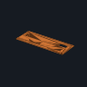 **Qty 1** · **Must meet:** ABS, 0.2 mm layers, 4 walls, 25–30 % infill, enclosed printer; settings and checks in this stage's checklist · files: [3d/CTL-10a_button_panel.step](phases/02-controller/3d/CTL-10a_button_panel.step)
  - *why:* Holds the SKR Pico, ESP32-S3, opto module and LED driver; panel labels
  - note:

## 03 · Frame

0/6 decided · still to buy $22.45 · [bom.csv](phases/03-frame/bom.csv) · [checklist](phases/03-frame/README.md)

- [ ] **FRM-06** M2 socket screw kit, 4–25 mm, with nuts and washers (900 pcs) — 1 × $7.58 = $7.58 · [buy at amazon.com](https://www.amazon.com/dp/B0DCKCN2WM) · status: suggested
  -  **Qty 1** · **Must meet:** M2-0.4 socket-head cap screws, stainless: ≥ 40 each of 8, 10, 12 mm and ≥ 20 of 16 mm, plus ≥ 100 nuts and washers; hex key 1.5 mm
  - *why:* Every printed join and module mount · 300 screws: 50 × 4/6/8, 40 × 10/12, 25 × 16/20, 20 × 25 mm. About 130 used. Self-tap into 1.7 mm printed pilots (set from the coupon).
  - note:
  - paid:
- [ ] **FRM-07** Socket screw kit M2/M3/M4 with nuts (820 pcs): M3 for the motors — 1 × $9.88 = $9.88 · [buy at amazon.com](https://www.amazon.com/dp/B0D636MJ1N) · status: suggested
  -  **Qty 1** · **Must meet:** M3-0.5 × 8 mm (≥ 12) and × 16 mm (≥ 4) socket-head cap screws with washers; hex key 2.5 mm
  - *why:* M3 x 8 into three NEMA 17 faces, M3 x 16 through the tilt-yoke arm into the fourth (the motors' own thread); spare M2 · Only M3 left in the machine: motors are threaded M3. Covers TBL-06, TLT-06, SPN-06.
  - note:
  - paid:
- [ ] **FRM-08** 608-2RS bearings (10) — 1 × $4.99 = $4.99 · [buy at amazon.com](https://www.amazon.com/dp/B0CX8CDL7D) · status: suggested
  -  **Qty 1** · **Must meet:** 608-2RS ball bearings, 8 × 22 × 7 mm, sealed
  - *why:* Table 2, tilt 2, spares 6
  - note:
  - paid:
- [ ] **FRM-01** Deck: 9 tiles of 200 mm (600 x 600 x 24 mm) — print · print · status: suggested
  - 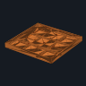 **Qty 1** · **Must meet:** ABS, 0.2 mm layers, 4 walls, 25–30 % infill, enclosed printer; settings and checks in this stage's checklist · files: [3d/FRM-01a_deck_tile_SW.step](phases/03-frame/3d/FRM-01a_deck_tile_SW.step)
  - *why:* Base for every part: replaces plywood · Bolted edge to edge with 36 x M2 x 10 + nuts (FRM-06). Pilot bosses at every mount point and a 40 mm grid of spare pilots: nothing to measure or mark. ≈ 1.4 kg ABS, ≈ 6 h per tile.
  - note:
- [ ] **FRM-02** Printed 20 x 20 bars: outrigger (2 x 250 mm), scan post (2 x 175 mm) — print · print · status: suggested
  - 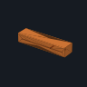 **Qty 1** · **Must meet:** ABS, 0.2 mm layers, 4 walls, 25–30 % infill, enclosed printer; settings and checks in this stage's checklist · files: [3d/FRM-02a_outrigger_bar_1.step](phases/03-frame/3d/FRM-02a_outrigger_bar_1.step)
  - *why:* Outrigger and scan-camera post: replaces aluminium extrusion · M2 self-tap pilots at every clamp station; bar couplers (FRM-09i) join the halves.
  - note:
- [ ] **FRM-09** Ring scale clamps, bar saddles, scan-post socket, camera pillar, end foot, bar couplers — print · print · status: suggested
  -  **Qty 1** · **Must meet:** ABS, 0.2 mm layers, 4 walls, 25–30 % infill, enclosed printer; settings and checks in this stage's checklist · files: [3d/FRM-09c_protractor_segment.step](phases/03-frame/3d/FRM-09c_protractor_segment.step)
  - *why:* Printed frame parts · Everything screws into the deck's pilots with M2 (FRM-06). The ring-scale segments also clamp the lazy Susan [R1].
  - note:

## 04 · Light arm (M4)

1/8 decided · still to buy $44.44 · [bom.csv](phases/04-light-arm/bom.csv) · [checklist](phases/04-light-arm/README.md)

- [ ] **LAR-01** 12 in lazy Susan bearing — 1 × $13.99 = $13.99 · [buy at amazon.com](https://www.amazon.com/dp/B0CQXFVDN7) · status: suggested
  -  **Qty 1** · **Must meet:** 12 in (≈ 305 mm) lazy-Susan ball bearing, flat, ≥ 50 kg rating, no wobble you can feel
  - *why:* M4: light arm rotates around the sample · Measure it before printing the rim (M13.1); the table motor needs an inner opening ≥ 150 mm.
  - note:
  - paid:
- [x] **LAR-02** NEMA 17 stepper 42 Ncm 1.5 A, 38 mm (5-pack: M4, M3, M2 + 2 spare) — 1 × $32.99 = $32.99 · [buy at amazon.com](https://www.amazon.com/dp/B088B756MY) · status: ordered
  -  **Qty 1** · **Must meet:** NEMA 17, 1.8°/step, bipolar 4-wire, ≥ 40 N·cm holding, ≤ 2.0 A/phase (driver runs 0.8 A), body ≤ 48 mm, 5 mm D-shaft
  - *why:* M4 drive · Bought. 5-pack covers LAR-02, TBL-01, TLT-01 and 2 spares. Its five 1 m cables (6-pin motor end, 4-pin XH board end in the photos): M4, M3, M2, one spliced to the M1 pancake (SPN-01), one spare. CAD clash check at 38 mm: 0 clashes on M4, M3, M2. Not for M1 (spin): that needs the 21.5 mm pancake (SPN-01).
  - note:
  - paid:
- [ ] **LAR-03** GT2 6 mm open belt (5 m) — 1 × $7.59 = $7.59 · [buy at amazon.com](https://www.amazon.com/dp/B0BSMNZ53S) · status: suggested
  -  **Qty 1** · **Must meet:** GT2 (2 mm pitch) open belt, 6 mm wide, fibre-reinforced, ≥ 1 m per ring (2 m bought)
  - *why:* Teeth-out around the ring rim (~24:1)
  - note:
  - paid:
- [ ] **LAR-04** GT2 20T pulley 5 mm bore (5-pack) — 1 × $3.99 = $3.99 · [buy at amazon.com](https://www.amazon.com/dp/B0DJQC42DT) · status: suggested
  -  **Qty 1** · **Must meet:** GT2 (2 mm pitch) 20-tooth, 5 mm bore, for 6 mm belt, 2 set screws
  - *why:* M4 motor pulley · 5-pack covers LAR-04, TBL-03, TLT-03.
  - note:
  - paid:
- [ ] **LAR-05** Optical endstop module, slot type (6-pack) — 1 × $8.99 = $8.99 · [buy at amazon.com](https://www.amazon.com/dp/B0719K9Z9R) · status: suggested
  -  **Qty 1** · **Must meet:** Slotted optical switch module (TCST2103, 3.1 mm slot), 3.3–5 V supply, digital output the controller endstop input reads
  - *why:* M4 home · Covers LAR-05, TBL-04, TLT-04, SPN-04. Check the slot is ≥ 3 mm (the flag is 1.5 mm).
  - note:
  - paid:
- [ ] **LAR-06** Roller-lever limit switch, sealed, 3 wires attached (2-pack) — 1 × $9.88 = $9.88 · [buy at amazon.com](https://www.amazon.com/dp/B09VGL29HS) · status: suggested
  -  **Qty 1** · **Must meet:** Momentary roller-lever microswitch with COM / NC / NO wires already attached (no solder, no crimp), NC contact rated ≥ 3 A DC
  - *why:* Over-travel switch in the motor-power line: cuts 24 V if the light arm runs past its range [R1] · Listing: 6 A at 12 V DC or 5 A at 250 V AC (no 24 V DC rating given). Wire colours on the units bought: black = COM, grey = NC, blue = NO (check yours with the meter: COM–NC beeps at rest, opens when the lever is pressed). Second switch spare.
  - note:
  - paid:
- [ ] **LAR-09** Laser module class 2 (650 nm, < 1 mW); mirror = one CAL-02 tile — 1 × $15.99 = $15.99 · tool · [buy at amazon.com](https://www.amazon.com/dp/B00ZR80S9S) · status: suggested
  -  **Qty 1** · **Must meet:** Red laser pointer, class 2 (< 1 mW), plus a ~25 mm flat mirror
  - *why:* Repeatability test: mirror on the moving part, spot on a wall 2 m away (0.1 deg = 7 mm) · Bare module, 2.6–6 V: run it from a spare 5 V and GND pin pair (SKR Pico RGB port: 5V pin 3, GND pin 1; README → Wiring → 8) with two jumper wires. Mirror: one CAL-02 tile.
  - note:
  - paid:
- [ ] **LAR-08** Belt rim segments, arm segment, M4 motor mount, cross clamp, upright + arm bars — print · print · status: suggested
  -  **Qty 1** · **Must meet:** ABS, 0.2 mm layers, 4 walls, 25–30 % infill, enclosed printer; settings and checks in this stage's checklist · files: [3d/LAR-08a_rim_segment.step](phases/04-light-arm/3d/LAR-08a_rim_segment.step)
  - *why:* Printed M4 parts · 7 rim segments + the arm segment (8th, with the upright socket) bolt to the lazy-Susan top plate with M2 x 12 + wide printed washer + nut (FRM-06, TBL-07f) where a slot meets a plate hole, CA glue elsewhere; no idlers: the motor pinion meshes with the rim belt. Printed 200 mm upright and arm bars.
  - note:

## 05 · Table (M3)

1/7 decided · still to buy $23.56 · [bom.csv](phases/05-table/bom.csv) · [checklist](phases/05-table/README.md)

- [x] **TBL-01** NEMA 17 stepper 42 Ncm 1.5 A, 38 mm — $0 (in another row) · [buy at amazon.com](https://www.amazon.com/dp/B088B756MY) · status: ordered
  -  **Qty 1** · **Must meet:** NEMA 17, 1.8°/step, bipolar 4-wire, ≥ 40 N·cm holding, ≤ 2.0 A/phase (driver runs 0.8 A), body ≤ 48 mm, 5 mm D-shaft
  - *why:* M3 (table rotation, vertical axis) drive · In the LAR-02 5-pack.
  - note:
  - paid:
- [ ] **TBL-02** GT2 6 mm closed belt 232 mm — 1 × $8.19 = $8.19 · [buy at amazon.com](https://www.amazon.com/dp/B0FRFGBS6J) · status: suggested
  -  **Qty 1** · **Must meet:** GT2 (2 mm pitch) closed loop, 6 mm wide, 232 mm (116 teeth): puts the motor 49.4 mm from the table axis, inside the lazy Susan opening
  - *why:* 20T to printed 100T, 5:1
  - note:
  - paid:
- [ ] **TBL-03** GT2 20T pulley 5 mm bore — $0 (in another row) · [buy at amazon.com](https://www.amazon.com/dp/B0DJQC42DT) · status: suggested
  -  **Qty 1** · **Must meet:** GT2 (2 mm pitch) 20-tooth, 5 mm bore, for 6 mm belt, 2 set screws
  - *why:* Motor pulley · In the LAR-04 5-pack.
  - note:
  - paid:
- [ ] **TBL-04** Optical endstop module, slot type (from the LAR-05 6-pack) — $0 (in another row) · [buy at amazon.com](https://www.amazon.com/dp/B0719K9Z9R) · status: suggested
  -  **Qty 1** · **Must meet:** Slotted optical switch module (TCST2103, 3.1 mm slot), 3.3–5 V supply, digital output the controller endstop input reads
  - *why:* Home · In the LAR-05 6-pack.
  - note:
  - paid:
- [ ] **TBL-05** M8 x 75 hex bolt, partial thread + M8 nut (fixed table axle) — 1 × $15.37 = $15.37 · [buy at amazon.com](https://www.amazon.com/dp/B0D83HW8ZM) · status: suggested
  -  **Qty 1** · **Must meet:** M8-1.25 × 75 mm hex bolt with ≥ 30 mm smooth shank (DIN 931, partial thread), grade 8.8, + M8 hex nut
  - *why:* Fixed axle: head locked in the post, drum turns on two 608s around it · Bolts $9.38 + nuts $5.99 (https://www.amazon.com/dp/B0CZQNB22Q); nuts also cover TLT-05.
  - note:
  - paid:
- [ ] **TBL-06** Axis fasteners (M3 motor face + M2 set) — $0 (in another row) · [buy at amazon.com](https://www.amazon.com/dp/B0D636MJ1N) · status: suggested
  -  **Qty 1** · **Must meet:** 4 × M3 × 8 for the NEMA 17 face; M2 socket screws 6–16 mm with nuts and washers
  - *why:* Motor face (M3), brackets, flags, clamps (M2) · From the FRM-06 and FRM-07 kits.
  - note:
  - paid:
- [ ] **TBL-07** Printed table parts — print · print · status: suggested
  - 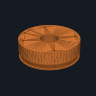 **Qty 1** · **Must meet:** ABS, 0.2 mm layers, 4 walls, 25–30 % infill, enclosed printer; settings and checks in this stage's checklist · files: [3d/TBL-07a_table_drum.step](phases/05-table/3d/TBL-07a_table_drum.step)
  - *why:* Post, drum (100T teeth + 608 seats + OG-40 top), motor bracket, flags, spacers, endstop riser
  - note:

## 06 · Camera and light

4/9 decided · still to buy $90.10 · [bom.csv](phases/06-camera-light/bom.csv) · [checklist](phases/06-camera-light/README.md)

- [ ] **CAM-01** USB camera 12 MP IMX477, M12 mount (UVC) — 1 × $59.99 = $59.99 · [buy at amazon.com](https://www.amazon.com/dp/B0C1G73QZD) · status: suggested
  -  **Qty 1** · **Must meet:** USB Video Class (UVC) camera, Sony IMX477 12.3 MP, 1.55 µm pixels, M12 × 0.5 lens mount, manual exposure / gain / white balance, ≥ 3840 × 3032 output, IR-cut filter for true colour
  - *why:* Fixed measurement camera on the laptop · Arducam's B0433-family 12 MP USB board.
  - note:
  - paid:
- [ ] **CAM-02** M12 lens 16 mm, ≥ 1/2 in format, low distortion — 1 × $30.11 = $30.11 · [buy at amazon.com](https://www.amazon.com/dp/B0HJWVFD7R) · status: suggested
  -  **Qty 1** · **Must meet:** M12 × 0.5 lens, focal length 16 mm (±0.5) → 124 × 98 mm field and 32 µm per pixel at 350 mm, 236 × 186 mm at 650 mm; covers a ≥ 1/2.3 in sensor; F2.0 or slower (used at f/8 via the 2.0 mm stop: 22.6 mm depth of field at 350 mm, 117 mm at 650 mm); distortion < 1 %
  - *why:* Lens
  - note:
  - paid:
- [x] **LSR-06** Solderless COB holder 13.5 mm (TE LUMAWISE Z35) — 1 × $3.30 = $3.30 · [buy at digikey.com](https://www.digikey.com/en/products/detail/te-connectivity-amp-connectors/2213678-5/6174915) · status: ordered
  -  **Qty 1** · **Must meet:** Solderless holder for a 13.5 × 13.5 mm COB (Citizen CLU700 / CLU701), poke-in terminals for 18–20 AWG wire, rated ≥ 0.5 A and ≥ 24 V
  - *why:* Holds and connects the COB without solder · Ordered 2 (1 spare). Ø35 × 3.6 mm, 3 A / 60 V DC, poke-in for 18–20 AWG solid or stranded [L23]; listed for the CLU701 [L26]. No screws: the lamp body's round seat centres it and the cap clamps heatsink + holder. Leads: 2 × PWR-15 18 AWG from the lamp lever connector.
  - note:
  - paid:
- [x] **LSR-01** COB LED CRI 90, 9 V, 13.5 mm (Citizen CLU701) — 1 × $4.60 = $4.60 · [buy at digikey.com](https://www.digikey.com/en/products/detail/citizen/CLU701-0303C4-273H5K2/5820601) · status: ordered
  -  **Qty 1** · **Must meet:** White chip-on-board LED, Colour Rendering Index (CRI) ≥ 90, 2700–5000 K, forward voltage ≤ 18 V at 350 mA (the driver steps down 4 V from 24 V), rated ≥ 350 mA, 13.5 × 13.5 mm board listed for LSR-06 in TE 114-32208
  - *why:* White measurement light · Ordered 2 (1 spare). Datasheet: Vf 8.6 / 9.4 / 10.2 V at 525 mA, max 690 mA, Tc ≤ 105 °C, Rj-c 3.5 °C/W; ≈ 3.2 W at 350 mA. TE 114-32208 lists the CLU701 for the Z35 2213678-5 [L26]. The square board sits in the holder's square seat; the round part is the holder.
  - note:
  - paid:
- [x] **LSR-02** Constant-current driver 350 mA, wire leads (MEAN WELL NLDD-350HW) — 1 × $7.20 = $7.20 · [buy at digikey.com](https://www.digikey.com/en/products/detail/mean-well-usa-inc/NLDD-350HW/13913611) · status: ordered
  -  **Qty 1** · **Must meet:** Constant-current LED driver 350 mA, input range covering 24 V, output covering the LED's ≈ 9 V, no flicker (DC output); wire leads that go under screw terminals or into lever connectors (no breadboard, no solder)
  - *why:* Drives the COB from 24 V; on/off from the SKR Pico HE (heater) MOSFET output · Ordered. 32.1 × 20.5 × 12.5 mm, input 10–56 V, output 4 V under the input, DIM open = on [L27]. Taped into its frame on the controller tray. Input leads straight under the SKR Pico HE screws; output leads into lever connectors; DIM lead alone in a lever connector. Match lead colours to functions from the label on the driver.
  - note:
  - paid:
- [x] **LSR-03** Heatsink 40 x 40 x 11.6 mm, pin fin (Wakefield 910) — 1 × $10.67 = $10.67 · [buy at digikey.com](https://www.digikey.com/en/products/detail/wakefield-thermal-solutions/910-40-2-12-2-B-0/4815166) · status: ordered
  -  **Qty 1** · **Must meet:** Aluminium heatsink 40 × 40 mm footprint, 11–12 mm tall, ≤ 10 °C/W in still air (keeps the LED case ≤ 70 °C at ≈ 2.5 W of heat)
  - *why:* COB cooling · Ordered. Digi-Key price not in your cart message: [TBD] on the store page; 10.67 is Mouser's qty-1 price via Octopart (2026-11-12). Sold for clip mounting with no tape: needs LSR-04.
  - note:
  - paid:
- [ ] **LSR-04** Thermal adhesive tape 3M 8810, 19 mm — $0 (in another row) · [buy at digikey.com](https://www.digikey.com/en/products/detail/3m-tc/8810-0-75-5/2649863) · status: suggested
  -  **Qty 1** · **Must meet:** Thermally conductive, electrically insulating adhesive tape or pad, ≥ 20 mm wide
  - *why:* COB to heatsink · Not ordered yet: the Wakefield heatsink comes without tape. Two 19 mm strips side by side cover the 13.5 mm board. Price [TBD]: check the store page and set it here.
  - note:
  - paid:
- [ ] **CAM-03** Camera L-arm, aperture stop (f/8), lens lock — print · print · status: suggested
  - 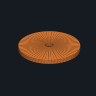 **Qty 1** · **Must meet:** Aperture stop hole = focal length / 8 = 2.0 mm (f/8); matte black ABS so it can't glint · files: [3d/CAM-03a_aperture_stop_f8.step](phases/06-camera-light/3d/CAM-03a_aperture_stop_f8.step)
  - *why:* Fixed, adjustable camera mount · Stop = f/N = 2.0 mm.
  - note:
- [ ] **LSR-05** Lamp body + tube, back cap — print · print · status: suggested
  - 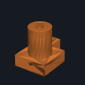 **Qty 1** · **Must meet:** ABS, 0.2 mm layers, 4 walls, 25–30 % infill, enclosed printer; settings and checks in this stage's checklist · files: [3d/LSR-05a_lamp_tube.step](phases/06-camera-light/3d/LSR-05a_lamp_tube.step)
  - *why:* Holds heatsink + COB holder, 10 mm exit aperture, polarizer slot, clamps to the printed arm bar (M2 into its pilot)
  - note:

## 07 · Calibrate → game material

0/12 decided · still to buy $39.78 · [bom.csv](phases/07-calibrate/bom.csv) · [checklist](phases/07-calibrate/README.md)

- [ ] **ENC-01** Blackout fabric, black (2 units) — 2 × $7.90 = $15.80 · optional · [buy at amazon.com](https://www.amazon.com/dp/B00MQADTVY) · status: suggested
  -  **Qty 2** · **Must meet:** Opaque blackout fabric, ≥ 2 yd × 54 in
  - *why:* Light-tight drape · Check the listing unit (per yard).
  - note:
  - paid:
- [ ] **ENC-02** Black felt sheet — 1 × $6.99 = $6.99 · [buy at amazon.com](https://www.amazon.com/dp/B0FXKGNV95) · status: suggested
  -  **Qty 1** · **Must meet:** Matte black felt, ≥ 9 × 12 in
  - *why:* Backdrop behind the sample
  - note:
  - paid:
- [ ] **ENC-03** Dowels 1/2 x 36 in (10) — 1 × $19.99 = $19.99 · optional · [buy at amazon.com](https://www.amazon.com/dp/B0BVGCCMZ9) · status: suggested
  -  **Qty 1** · **Must meet:** ½ in (12.7 mm) hardwood dowels (poplar is fine), 36 in, straight
  - *why:* Drape frame posts · Bamboo; 4 used.
  - note:
  - paid:
- [ ] **CAL-01** PTFE sheets 100 x 100 x 3 mm (2): white tile = 3 stacked 50 mm squares — 1 × $16.99 = $16.99 · [buy at amazon.com](https://www.amazon.com/dp/B0F83XRXTV) · status: suggested
  -  **Qty 1** · **Must meet:** Virgin white PTFE; 3 stacked 3 mm squares = 9 mm (opaque, like a 3/8 in plate), ≥ 50 × 50 mm face; top sanded with 400 grit for a diffuse surface (reflectance ≈ 0.98–0.99)
  - *why:* Near-Lambertian white reference · Cut one sheet into four 50 mm squares (knife); stack 3 in the holder.
  - note:
  - paid:
- [ ] **CAL-02** Glass mirror tile ~50 mm — 1 × $11.49 = $11.49 · [buy at amazon.com](https://www.amazon.com/dp/B01H0ZU1QA) · status: suggested
  -  **Qty 1** · **Must meet:** Flat glass mirror ≈ 50 mm; front-surface preferred (no ghost reflection)
  - *why:* Geometric calibration (specular peak)
  - note:
  - paid:
- [ ] **CAL-03** Chrome steel ball 1 in G25 (2) — 1 × $9.95 = $9.95 · optional · [buy at amazon.com](https://www.amazon.com/dp/B01AX6ZRH6) · status: suggested
  -  **Qty 1** · **Must meet:** Two 1 in chrome-steel balls, grade 25 or better (polished)
  - *why:* Optional check of light directions (photometric stereo); light direction already comes from M4 and the mirror test
  - note:
  - paid:
- [ ] **CAL-04** ChArUco print + picture-frame glass — 1 × $4.31 = $4.31 · [buy at amazon.com](https://www.amazon.com/dp/B000Y79K32) · status: suggested
  -  **Qty 1** · **Must meet:** ChArUco board 7 × 5, 10 mm squares, 7 mm markers (DICT_4X4_50), printed at 100 % on matte paper, held flat under glass
  - *why:* Intrinsics, pose, repeatability · Check it has real glass (the board must be flat). Print the ChArUco board on the TLS-08 printer.
  - note:
  - paid:
- [ ] **CAL-05** Colour target (ColorChecker Mini or similar) — 1 × $55.50 = $55.50 · optional · [buy at amazon.com](https://www.amazon.com/dp/B0973JNJCB) · status: suggested
  -  **Qty 1** · **Must meet:** 24-patch colour checker with published reference values
  - *why:* Colour validation, as in [R1]
  - note:
  - paid:
- [ ] **ENC-05** Flocked light-trap sheet, self-adhesive — 1 × $12.73 = $12.73 · optional · [buy at amazon.com](https://www.amazon.com/dp/B0FJRWTXXF) · status: suggested
  -  **Qty 1** · **Must meet:** Flocked light-trap material, self-adhesive, absorbs > 99 %
  - *why:* Line the backdrop and the lamp tube: kills stray reflections
  - note:
  - paid:
- [ ] **CAL-07** 18 % grey card + white card set (8 x 10 in) — 1 × $11.99 = $11.99 · optional · [buy at amazon.com](https://www.amazon.com/dp/B00CJ59AKK) · status: suggested
  -  **Qty 1** · **Must meet:** 18 % neutral grey card, matte, ≥ 4 × 5 in
  - *why:* Lock exposure and white balance (M17.5); warm-up target (M18.3)
  - note:
  - paid:
- [ ] **ENC-04** Dowel sockets, drape clips — print · print · status: suggested
  - 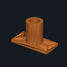 **Qty 1** · **Must meet:** ABS, 0.2 mm layers, 4 walls, 25–30 % infill, enclosed printer; settings and checks in this stage's checklist · files: [3d/ENC-04a_dowel_socket.step](phases/07-calibrate/3d/ENC-04a_dowel_socket.step)
  - *why:* Enclosure hardware
  - note:
- [ ] **CAL-06** Kinematic holders for mirror, PTFE, balls — print · print · status: suggested
  - 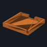 **Qty 1** · **Must meet:** ABS, 0.2 mm layers, 4 walls, 25–30 % infill, enclosed printer; settings and checks in this stage's checklist · files: [3d/CAL-06a_ptfe_holder.step](phases/07-calibrate/3d/CAL-06a_ptfe_holder.step)
  - *why:* Fixtures on the stage
  - note:

## 08 · Tilt (M2)

1/7 decided · still to buy $16.68 · [bom.csv](phases/08-tilt/bom.csv) · [checklist](phases/08-tilt/README.md)

- [x] **TLT-01** NEMA 17 stepper 42 Ncm 1.5 A, 38 mm — $0 (in another row) · [buy at amazon.com](https://www.amazon.com/dp/B088B756MY) · status: ordered
  -  **Qty 1** · **Must meet:** NEMA 17, 1.8°/step, bipolar 4-wire, ≥ 40 N·cm holding, ≤ 2.0 A/phase (driver runs 0.8 A), body ≤ 48 mm, 5 mm D-shaft
  - *why:* M2 (sample tilt, horizontal axis) drive · In the LAR-02 5-pack.
  - note:
  - paid:
- [ ] **TLT-02** GT2 6 mm closed belt 280 mm — 1 × $7.49 = $7.49 · [buy at amazon.com](https://www.amazon.com/dp/B07RK1TX8C) · status: suggested
  -  **Qty 1** · **Must meet:** GT2 6 mm closed loop, 280 mm
  - *why:* 20T to printed 100T, 5:1
  - note:
  - paid:
- [ ] **TLT-03** GT2 20T pulley 5 mm bore — $0 (in another row) · [buy at amazon.com](https://www.amazon.com/dp/B0DJQC42DT) · status: suggested
  -  **Qty 1** · **Must meet:** GT2 (2 mm pitch) 20-tooth, 5 mm bore, for 6 mm belt, 2 set screws
  - *why:* Motor pulley · In the LAR-04 5-pack.
  - note:
  - paid:
- [ ] **TLT-04** Optical endstop module, slot type (from the LAR-05 6-pack) — $0 (in another row) · [buy at amazon.com](https://www.amazon.com/dp/B0719K9Z9R) · status: suggested
  -  **Qty 1** · **Must meet:** Slotted optical switch module (TCST2103, 3.1 mm slot), 3.3–5 V supply, digital output the controller endstop input reads
  - *why:* Home · In the LAR-05 6-pack.
  - note:
  - paid:
- [ ] **TLT-05** M8 x 35 hex bolts, half thread (10-pack; 2 used) — 1 × $9.19 = $9.19 · [buy at amazon.com](https://www.amazon.com/dp/B08KSVMT7W) · status: suggested
  -  **Qty 1** · **Must meet:** 2 × M8-1.25 × 35 mm hex bolt (DIN 931, smooth shank under the bearing), grade 8.8, + 2 M8 hex nuts
  - *why:* Cradle turns on two stub axles in the yoke's 608s · Nuts from the TBL-05 pack.
  - note:
  - paid:
- [ ] **TLT-06** Axis fasteners (M3 motor face + M2 set) — $0 (in another row) · [buy at amazon.com](https://www.amazon.com/dp/B0D636MJ1N) · status: suggested
  -  **Qty 1** · **Must meet:** 4 × M3 × 16 for the NEMA 17 face (through the 12 mm yoke arm); M2 socket screws 6–16 mm with nuts and washers
  - *why:* Motor face (M3), brackets, flags, clamps (M2) · From the FRM-06 and FRM-07 kits.
  - note:
  - paid:
- [ ] **TLT-07** Printed tilt parts — print · print · status: suggested
  - 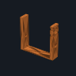 **Qty 1** · **Must meet:** ABS, 0.2 mm layers, 4 walls, 25–30 % infill, enclosed printer; settings and checks in this stage's checklist · files: [3d/TLT-07a_tilt_yoke.step](phases/08-tilt/3d/TLT-07a_tilt_yoke.step)
  - *why:* Yoke (motor slots above the axis), 100T pulley, cradle
  - note:

## 09 · Spin (M1)

1/4 decided · still to buy $0.00 · [bom.csv](phases/09-spin/bom.csv) · [checklist](phases/09-spin/README.md)

- [x] **SPN-01** NEMA 17 pancake stepper 16 Ncm 1 A (direct drive) — 1 × $11.99 = $11.99 · [buy at amazon.com](https://www.amazon.com/dp/B00PNEQ79Q) · status: ordered
  -  **Qty 1** · **Must meet:** NEMA 17 pancake, body ≤ 25 mm, 1.8°/step, ≥ 13 N·cm, ≤ 1.0 A, 5 mm D-shaft ≥ 16 mm (driver at 1/64 microstep)
  - *why:* M1 spin: the platter sits on its shaft · Bought. Fixed bare leads, no connector (listing photo): spliced to a spare LAR-02 cable (6-pin plug cut off) with 3 × WAGO 221-412 + 1 × 221-415 (fine-stranded 0.14–4 mm²), XH 4-pin end into the SKR Pico E socket. Wiring: README → Wiring, M27.1. Same frame and shaft, also fits: STEPPERONLINE 17HE08-1004S (B0B93PNYCP); check its shaft length ≥ 16 mm and D flat.
  - note:
  - paid:
- [ ] **SPN-04** Optical endstop module, slot type (from the LAR-05 6-pack) — $0 (in another row) · [buy at amazon.com](https://www.amazon.com/dp/B0719K9Z9R) · status: suggested
  -  **Qty 1** · **Must meet:** Slotted optical switch module (TCST2103, 3.1 mm slot), 3.3–5 V supply, digital output the controller endstop input reads
  - *why:* Home · In the LAR-05 6-pack.
  - note:
  - paid:
- [ ] **SPN-06** Axis fasteners (M3 motor face + M2 set) — $0 (in another row) · [buy at amazon.com](https://www.amazon.com/dp/B0D636MJ1N) · status: suggested
  -  **Qty 1** · **Must meet:** 4 × M3 × 8 for the NEMA 17 face; M2 socket screws 6–16 mm with nuts and washers
  - *why:* Motor face (M3), brackets, flags, clamps (M2) · From the FRM-06 and FRM-07 kits.
  - note:
  - paid:
- [ ] **SPN-07** Spin platter (direct drive) — print · print · status: suggested
  - 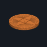 **Qty 1** · **Must meet:** ABS, 0.2 mm layers, 4 walls, 25–30 % infill, enclosed printer; settings and checks in this stage's checklist · files: [3d/SPN-07a_spin_platter.step](phases/09-spin/3d/SPN-07a_spin_platter.step)
  - *why:* Sample face; clamps the motor's D-shaft with an M3 grub in a captive nut
  - note:

## 10 · Colour add-ons (optional)

0/9 decided · still to buy $0.00 · [bom.csv](phases/10-color/bom.csv) · [checklist](phases/10-color/README.md)

- [ ] **MSK-01** Narrow-band 3 W star LEDs, pre-soldered leads (7 bands, 450–660 nm) — 7 × $10.99 = $76.93 · optional · [buy at amazon.com](https://www.amazon.com/dp/B0GJMJ5MWN) · status: suggested
  -  **Qty 7** · **Must meet:** Narrow-band LEDs on 20 mm stars with pre-soldered wire leads (no solder), 1–3 W, bandwidth ≤ 30 nm, spread over 450–660 nm
  - *why:* Colour bands · BLOCKED (audit F09): do not buy or power until the LED driver circuit is reviewed (design.md). One pack per band, $10.99 each (lens angle doesn't matter: the lenses are left off). The yellow and orange listings give no wavelength (typically ≈ 590 / ≈ 605 nm): measure them with the SPC sensor. Ring slot 8 stays spare. The first-draft CHANZON parts are bare chips that need soldering.
  - note:
  - paid:
- [ ] **MSK-02** Constant-current driver 350 mA — 1 × $5.41 = $5.41 · optional · [buy at digikey.com](https://www.digikey.com/en/products/detail/mean-well-usa-inc/NLDD-350H/13913618) · status: suggested
  -  **Qty 1** · **Must meet:** Constant-current LED driver 350 mA, input covering 24 V
  - *why:* One driver, one LED on at a time · BLOCKED (audit F09): do not buy or power until the LED driver circuit is reviewed (design.md). 
  - note:
  - paid:
- [ ] **MSK-03** 4-channel MOSFET switch module, opto-isolated inputs, screw terminals (2 used: 8 channels) — 2 × $7.39 = $14.78 · optional · [buy at amazon.com](https://www.amazon.com/dp/B0GY97176W) · status: suggested
  -  **Qty 2** · **Must meet:** 4-channel low-side MOSFET module, isolated inputs that switch at 3.3 V (3–20 V input), ≥ 0.5 A per channel at 24 V, screw terminals on every input and output (no solder)
  - *why:* The ESP32-S3 hub selects the band (low-side switch on each LED cathode) · BLOCKED (audit F09): do not buy or power until the LED driver circuit is reviewed (design.md). Replaces the ULN2803A chip, which needed a breadboard. Same wiring: LED cathode → OUTn, inputs ← ESP32-S3 GPIO 8–14 and 21.
  - note:
  - paid:
- [ ] **MSK-04** Heatsink 40 mm (second LSR-03) — 1 × $10.67 = $10.67 · optional · [buy at digikey.com](https://www.digikey.com/en/products/detail/wakefield-thermal-solutions/910-40-2-12-2-B-0/4815166) · status: suggested
  -  **Qty 1** · **Must meet:** Aluminium heatsink ≥ 40 × 40 mm
  - *why:* LED bank cooling · Optional colour kit (stage 10). Price is Mouser's qty-1 via Octopart; Digi-Key price [TBD].
  - note:
  - paid:
- [ ] **MSK-05** Linear polarizer film 10 x 10 cm (10) — 1 × $6.83 = $6.83 · optional · [buy at amazon.com](https://www.amazon.com/dp/B0FX4P45HD) · status: suggested
  -  **Qty 1** · **Must meet:** Linear polarizer film for visible light; crossed ÷ parallel ≤ 1/20 when tested
  - *why:* Polarized capture (specular/diffuse separation)
  - note:
  - paid:
- [ ] **SPC-01** AS7341 spectral sensor breakout, 8 visible bands + clear + NIR (STEMMA QT) — 1 × $18.95 = $18.95 · optional · [buy at adafruit.com](https://www.adafruit.com/product/4698) · status: suggested
  -  **Qty 1** · **Must meet:** AS7341 spectral sensor breakout (8 visible bands + clear + NIR), I²C address 0x39, 3.3 V, STEMMA QT / Qwiic
  - *why:* Spectral reading of the spot at the zero point · I2C 0x39 on ESP32-S3 GPIO 1 (SDA) / 2 (SCL), shared with the OLED
  - note:
  - paid:
- [ ] **SPC-02** JST-SH 4-pin to female jumper cable 150 mm — 1 × $0.95 = $0.95 · optional · [buy at adafruit.com](https://www.adafruit.com/product/4397) · status: suggested
  -  **Qty 1** · **Must meet:** JST-SH 4-pin (STEMMA QT) to female 2.54 mm sockets, ≈ 150 mm
  - *why:* Sensor to the ESP32-S3 hub
  - note:
  - paid:
- [ ] **MSK-06** LED bank ring on a 40 deg mast, polarizer holders — print · print · status: suggested
  - 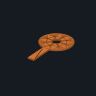 **Qty 1** · **Must meet:** ABS, 0.2 mm layers, 4 walls, 25–30 % infill, enclosed printer; settings and checks in this stage's checklist · files: [3d/MSK-06a_led_ring.step](phases/10-color/3d/MSK-06a_led_ring.step)
  - *why:* 40° mast: 2nd light height
  - note:
- [ ] **SPC-03** Spectral sensor tube + mount — print · print · status: suggested
  - 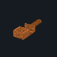 **Qty 1** · **Must meet:** ABS, 0.2 mm layers, 4 walls, 25–30 % infill, enclosed printer; settings and checks in this stage's checklist · files: [3d/SPC-03a_spectral_tube.step](phases/10-color/3d/SPC-03a_spectral_tube.step)
  - *why:* 3 mm aperture, ~4 deg field; sits above the camera lens
  - note:

## 11 · 3D scan: capture

0/5 decided · still to buy $2.33 · [bom.csv](phases/11-scan-capture/bom.csv) · [checklist](phases/11-scan-capture/README.md)

- [ ] **SCN-01** Mounting putty 2 oz — 1 × $2.33 = $2.33 · [buy at amazon.com](https://www.amazon.com/dp/B003LZMHIY) · status: suggested
  -  **Qty 1** · **Must meet:** Removable mounting putty
  - *why:* Holds objects on the tilted platter during scans
  - note:
  - paid:
- [ ] **SCN-02** ChArUco scanning mat (printed on TLS-08) — $0 (in another row) · [buy at amazon.com](https://www.amazon.com/dp/B01FV0F8H8) · status: suggested
  -  **Qty 1** · **Must meet:** ChArUco mat printed at 100 % on matte paper
  - *why:* Scale and pose check under the object · In the TLS-11 paper. Free generator: ChArUco, Letter, print at 100 %.
  - note:
  - paid:
- [ ] **CAM-04** Second USB camera 12 MP IMX477, M12 mount (scan camera) — 1 × $59.99 = $59.99 · optional · [buy at amazon.com](https://www.amazon.com/dp/B0C1G73QZD) · status: suggested
  -  **Qty 1** · **Must meet:** Identical to CAM-01 (same sensor, so the same settings and calibration steps)
  - *why:* No-switching kit: the scan camera stays at 650 mm; the measuring camera never moves or refocuses
  - note:
  - paid:
- [ ] **CAM-05** Second M12 16 mm lens (scan camera) — 1 × $30.11 = $30.11 · optional · [buy at amazon.com](https://www.amazon.com/dp/B0HJWVFD7R) · status: suggested
  -  **Qty 1** · **Must meet:** Identical to CAM-02: 16 mm focal length (236 × 186 mm field at 650 mm), used at f/8 (2.0 mm stop)
  - *why:* No-switching kit: the scan camera stays at 650 mm; the measuring camera never moves or refocuses
  - note:
  - paid:
- [ ] **SCN-03** Platter risers (20/40/60 mm), scan camera plate (15 deg) — print · print · status: suggested
  - 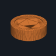 **Qty 1** · **Must meet:** ABS, 0.2 mm layers, 4 walls, 25–30 % infill, enclosed printer; settings and checks in this stage's checklist · files: [3d/SCN-03a_riser_20.step](phases/11-scan-capture/3d/SCN-03a_riser_20.step)
  - *why:* Object centre at the zero point · δ = 60 − riser height.
  - note:

## 15 · Standalone (no laptop)

0/10 decided · still to buy $0.00 · [bom.csv](phases/15-standalone/bom.csv) · [checklist](phases/15-standalone/README.md)

- [ ] **STA-01** Raspberry Pi Zero 2 WH (header soldered) — 1 × $19.80 = $19.80 · optional · [buy at adafruit.com](https://www.adafruit.com/product/6008) · status: suggested
  -  **Qty 1** · **Must meet:** Raspberry Pi Zero 2 W with factory-soldered 40-pin header (Zero 2 WH), 64-bit, WiFi
  - *why:* Runs opengonio station: jobs + camera without the laptop · Out of stock at Adafruit when checked. Header pre-soldered: jumpers push on. MSRP; any approved reseller.
  - note:
  - paid:
- [ ] **STA-02** microSD card 32 GB — 1 × $18.99 = $18.99 · optional · [buy at amazon.com](https://www.amazon.com/dp/B0DR926VXL) · status: suggested
  -  **Qty 1** · **Must meet:** microSD ≥ 16 GB, A1 class
  - *why:* Pi OS + job data
  - note:
  - paid:
- [ ] **STA-03** Buck converter 24 V to 5 V 3 A — 1 × $7.99 = $7.99 · optional · [buy at amazon.com](https://www.amazon.com/dp/B0DBVYP91F) · status: suggested
  -  **Qty 1** · **Must meet:** Buck converter 18–24 V in → 5.1 V out, ≥ 3 A, screw terminals on input and output
  - *why:* Powers the Pi from the pack (after the fuse, before the e-stop: the Pi stays up when the e-stop is pressed) · Wired under the jack's +/− screws, before the e-stop: the Pi draws ~2–3 W whenever the adapter is plugged in. Set it to 5.1 V with the trimmer before connecting the Pi; check for screw terminals.
  - note:
  - paid:
- [ ] **STA-04** Micro-USB OTG adapter — 1 × $2.50 = $2.50 · optional · [buy at adafruit.com](https://www.adafruit.com/product/1099) · status: suggested
  -  **Qty 1** · **Must meet:** Micro-USB OTG to USB-A adapter, then a powered USB hub (camera + SKR Pico USB-C cable)
  - *why:* Camera and the SKR Pico into the Pi USB port · A powered USB hub is also needed in standalone mode (two devices on one port); it is not in this list yet: choose one when you reach stage 15.
  - note:
  - paid:
- [ ] **STA-05** SSD1306 OLED 0.96 in I2C 128x64 — 1 × $17.50 = $17.50 · optional · [buy at adafruit.com](https://www.adafruit.com/product/326) · status: suggested
  -  **Qty 1** · **Must meet:** SSD1306 OLED 128 × 64, I²C, 3.3 V, address 0x3C, 4-pin header pre-soldered
  - *why:* Menu and progress on the panel (both modes) · Check the address is 0x3C (some are 0x3D).
  - note:
  - paid:
- [ ] **STA-06** Jumper wires female-female (10) — 1 × $1.95 = $1.95 · optional · [buy at adafruit.com](https://www.adafruit.com/product/1950) · status: suggested
  -  **Qty 1** · **Must meet:** Female–female 2.54 mm jumper wires
  - *why:* Pi UART to the ESP32-S3 hub; OLED · Consumable: set `have` if it's in your drawer.
  - note:
  - paid:
- [ ] **STA-08** USB-A to micro-B data cable 1 m — 1 × $2.95 = $2.95 · optional · [buy at adafruit.com](https://www.adafruit.com/product/592) · status: suggested
  -  **Qty 1** · **Must meet:** USB-A to micro-B data cable (not charge-only), ≤ 1 m
  - *why:* Pi OTG port to a USB hub / camera
  - note:
  - paid:
- [ ] **STA-09** Status screen 2 in IPS 240 x 320, SPI (Waveshare 2inch LCD Module) — $0 (in another row) · optional · [buy at amazon.com](https://www.amazon.com/dp/B081Q79X2F) · status: suggested
  -  **Qty 1** · **Must meet:** ST7789 or ST7789VW 2.0 in IPS LCD, 240 × 320, 4-wire SPI, 3.3 V logic and supply, 8 pins VCC GND DIN CLK CS DC RST BL, cable ending in 2.54 mm female jumper ends (no solder)
  - *why:* Hub status on demand without the app: power, keys, laptop link, last spectral reading (SCREEN ON) · Price [TBD]: check the store page and set it here. Box: module + 20 cm PH2.0 8-pin cable [L30]; the maker page does not say what its far end is: check the listing shows 8 female jumper ends before buying. Wiring: addons.html. Holder: STA-10 (M2 × 8, no screws into the module).
  - note:
  - paid:
- [ ] **STA-07** Pi Zero mount + OLED window — print · print · status: suggested
  - 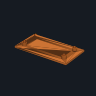 **Qty 1** · **Must meet:** ABS, 0.2 mm layers, 4 walls, 25–30 % infill, enclosed printer; settings and checks in this stage's checklist · files: [3d/STA-07a_pi_zero_mount.step](phases/15-standalone/3d/STA-07a_pi_zero_mount.step)
  - *why:* Clips into the controller case
  - note:
- [ ] **STA-10** Status screen stand + bezel — print · print · status: suggested
  - 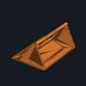 **Qty 1** · **Must meet:** ABS, 0.2 mm layers, 4 walls, 25–30 % infill, enclosed printer; settings and checks in this stage's checklist · files: [3d/STA-10a_screen_stand.step](phases/15-standalone/3d/STA-10a_screen_stand.step)
  - *why:* Holds STA-09 at 30° from vertical beside the controller tray, facing the laptop side · The bezel clamps only the module's two short ends (4 mm each), so its holes and thickness need not be known. Check on the real module before printing: the display sits inside the 50 mm window and back-side parts clear the 3 mm ledge.
  - note:
