# Gonioreflectometer-Open-Source

Measures how materials reflect light — the bidirectional reflectance distribution function (BRDF) — and scans objects in 3D. Four motorised axes turn the sample and a lamp around a fixed camera. Runs from a laptop or on its own. Design after [Ansari-Asl et al. (2024)](https://doi.org/10.3390/jimaging10030055).

- **Printed parts, M2 screws and electronic modules.** The deck, posts and arms are 3D printed; every join is an M2 screw into a printed pilot (M3 only into the motors); electronics are modules joined by screw terminals, lever connectors and plug-in leads. A circuit-board version is specified for later: [pcb/](pcb/README.md).
- **No soldering, drilling, sawing or crimping.** Tools: 3D printer, hex keys, screwdrivers, wire stripper, knife, multimeter.
- **Every part from Digi-Key, Amazon or Adafruit**, each with a 3D model (STEP + STL) in this repo. Prices checked October 2026.

**Key features**

- **Reflectance, in and out of the plane.** A lamp on a 12 inch ring (M4), a turning table (M3), a tilt (M2) and a spin (M1) put light and view anywhere over a flat sample up to 50 mm; a fixed camera records every pose.
- **A material at the end.** `opengonio` turns a run into a reflectance curve (CSV, comma-separated values) and fits base colour, roughness and metallic for glTF, Blender, Unity and Unreal.
- **3D scans** of small objects from the same machine (stages 11–13).
- **A control app** in the browser or a desktop window: connect, home, jog, light, capture and see the curve ([Website and app](#website-and-app)).
- **Every control works without hardware.** A simulated machine with a hidden table error runs the whole chain; `make sim` ends `ALL PASS`.
- **Honest numbers.** Every claim says whether it is simulated, modeled or measured ([Status](#status)).

**New here?** Open the [project map](docs/explore/index.html): the whole project as a clickable map, with a 9-step tour in plain words (what it measures, how a run works, the build stages, the boards, the software) and a flows view of how things happen. Drawn from the repo by `tools/explore_graph.py` with [Understand-Anything](https://github.com/Egonex-AI/Understand-Anything) (MIT).

**See inside:** [Inside OpenGonio](docs/inside.html) shows every software module, test, firmware setting, wire and roadmap step, read from the repo by `tools/inside_data.py`; the [control app](docs/app/index.html) runs the real Python in the browser on the simulated machine. Website pages need the website or a local server: `python3 -m http.server -d docs 8000`, then `http://localhost:8000/inside.html`.

**[How it works](wiki/How-it-works.md) · [Wiring](#wiring) · [Build steps](#build) · [Wiki](wiki/Home.md) · [Paper (PDF)](paper/build/opengonio.pdf) · [Website](docs/index.html) · [Lab](docs/lab.html) · [Parts spreadsheet](exports/bom/opengonio-bom.xlsx) · [Your parts list](PARTS.md)**

<!-- budget:start -->
| Plan (every core part bought) | Still to buy | Have / ordered | Paid so far | Decided | Tools to buy (kept, separate) |
|---:|---:|---:|---:|---:|---:|
| $495.19 | $450.21 | $44.98 | $0.00 | 4/103 parts | $469.76 |

Optional spectral sensor +\$19.90 · Optional standalone kit +\$71.68 · Optional no-switching camera kit +\$90.10 · Optional colour kit (bands + polarizers) +\$103.95
<!-- budget:end -->

**Cost scope.** "Plan" is every core part for the white-light instrument at listed prices (October 2026), before shipping and tax. It leaves out the tools (bought once, kept), the optional kits on the line above, and the laptop.

## At a glance

| | Choice | To the laptop |
|---|---|---|
| Motion board | BTT SKR Pico V1.0 running grblHAL: 4 × TMC2209 drivers, 4 home inputs, lamp and fan outputs | USB-C |
| Button + sensor hub | ESP32-S3-DevKitC-1 (owned) running MicroPython: 2 keypads, motor-power sense, optional OLED / spectral sensor | USB-C |
| Motors | NEMA 17 17HS4401 5-pack for M4 arm, M3 table, M2 tilt (+2 spare) · 17HS08-1004S pancake for M1 spin (both bought) | — |
| Camera | Arducam 12 MP IMX477 USB camera, 16 mm M12 lens at f/8 | USB |
| Light | Citizen COB, CRI 97, 350 mA constant-current driver switched by the SKR Pico | — |
| Power | 24 V 3 A wall adapter with a screw-terminal jack, latching e-stop in its own box, pre-wired limit switch (over-travel) | — |
| Prints | black ABS (cuts stray reflections), enclosed printer, M2 self-tapping screws | — |

**Contents:** [Status](#status) · [Electronics](#electronics) · [Mechanical](#mechanical) · [Printed parts](#printed-parts) · [Tools](#tools) · [Wiring](#wiring) · [Build](#build) · [Software](#software) · [Website and app](#website-and-app) · [Project structure](#project-structure) · [Design](#design) · [Licence](#licence)

## Status

**Design stage: no machine has been built or measured yet.** The software, CAD and build steps exist and are tested on a simulated machine; every hardware claim below is a design value until a built machine's run folder backs it. Full evidence table, uncertainty budget and acceptance tests: [evaluation specification](docs/specification/evaluation.md).

| Capability | Evidence today |
|---|---|
| In-plane and out-of-plane BRDF, white light, flat samples ≤ 50 mm | simulated end to end (`make sim`) |
| Absolute BRDF against a polytetrafluoroethylene (PTFE) reference, camera response, lamp drift checks | simulated; uncertainty not characterized |
| Repeatability ≤ 0.1° per axis | modeled (step size); not measured |
| No part collisions over every axis' travel | modeled (CAD sweep + mixed poses) |
| AS7341 spectral readings (8 visible bands + clear + NIR) | not characterized (firmware untested) |
| Colour LED bank (stage 10) | **blocked**: driver circuit unsafe as designed, do not power |
| 3D scan: visual hull | simulated |
| 3D scan: photometric stereo | simulated; needs the blocked LED bank |
| 24 V wall adapter, 3 A: 1.3 A peak draw | modeled from listing values |
| Electrical safety | not certified (only 24 V inside the machine: wall adapter with short-circuit protection per its listing, e-stop, limit switch) |

Try it without hardware: `make setup && source .venv/bin/activate && make sim` ends with `ALL PASS`. Installed from a wheel instead of the repository: `opengonio init` puts an editable `machine.yaml` in `~/.config/opengonio/`.

## Electronics

Click a picture for the 3D view. **STEP** / **STL**: true-size model to download · **open model**: the maker's own model · **maker**: the maker's CAD page.

<!-- bom-electronics:start -->
| | Part | Qty | Price | Buy | 3D model |
|:-:|---|:-:|--:|---|---|
| <a href="cad/bought/PWR-30_dc_jack_screw_terminal.stl">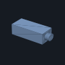</a> | **PWR-30** 24 V 3 A wall adapter with screw-terminal DC jack | 1 | \$17.85 | [Amazon](https://www.amazon.com/dp/B078RY7BPL) | [STEP](cad/bought/PWR-30_dc_jack_screw_terminal.step?raw=true) · [STL](cad/bought/PWR-30_dc_jack_screw_terminal.stl?raw=true) |
| <a href="cad/bought/PWR-28_estop_station_1no1nc.stl">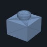</a> | **PWR-28** Emergency stop in its own box, latching, 1 NO + 1 NC, screw terminals | 1 | \$8.99 | [Amazon](https://www.amazon.com/dp/B00NTT91Y0) | [STEP](cad/bought/PWR-28_estop_station_1no1nc.step?raw=true) · [STL](cad/bought/PWR-28_estop_station_1no1nc.stl?raw=true) |
| <a href="cad/bought/PWR-10_pc817_opto_module_24v.stl">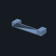</a> | **PWR-10** Optocoupler module PC817, 24 V input, screw terminals (2-pack) | 1 | \$6.99 | [Amazon](https://www.amazon.com/dp/B0B5382ZT7) | [STEP](cad/bought/PWR-10_pc817_opto_module_24v.step?raw=true) · [STL](cad/bought/PWR-10_pc817_opto_module_24v.stl?raw=true) |
| <a href="cad/bought/PWR-15_wire_18awg_pair.stl">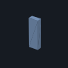</a> | **PWR-15** 18 AWG silicone wire red/black, 1.5 m (5 ft) each colour | 1 | \$7.98 | [Amazon](https://www.amazon.com/dp/B01708AYYQ) | [STEP](cad/bought/PWR-15_wire_18awg_pair.step?raw=true) · [STL](cad/bought/PWR-15_wire_18awg_pair.stl?raw=true) |
| <a href="cad/bought/PWR-20_wago_221_assortment_12.stl"></a> | **PWR-20** Lever wire connectors, WAGO 221 assortment (12) | 1 | \$12.45 | [Amazon](https://www.amazon.com/dp/B0CJ5QF4Z2) | [STEP](cad/bought/PWR-20_wago_221_assortment_12.step?raw=true) · [STL](cad/bought/PWR-20_wago_221_assortment_12.stl?raw=true) · [maker](https://www.wago.com/ch-de/installationsklemmen/compact-verbindungsklemme/p/221-412) |
| <a href="cad/bought/CTL-01_btt_skr_pico_envelope.stl">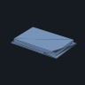</a> | **CTL-01** BIGTREETECH SKR Pico V1.0 (RP2040, 4 × TMC2209 UART, USB-C) | 1 | \$35.99 | [Amazon](https://www.amazon.com/dp/B09MYKL9MP) | [STEP](cad/bought/CTL-01_btt_skr_pico_envelope.step?raw=true) · [STL](cad/bought/CTL-01_btt_skr_pico_envelope.stl?raw=true) · [maker](https://github.com/bigtreetech/SKR-Pico/blob/master/3D/BTT%20SKR%20Pico%20V1.0.step) |
| <a href="cad/bought/CTL-03_usb_cable_e4.stl">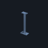</a> | **CTL-03** USB-A to USB-C data cables, 3 ft (2-pack) | 1 | \$8.99 | [Amazon](https://www.amazon.com/dp/B07DD5YHMH) | [STEP](cad/bought/CTL-03_usb_cable_e4.step?raw=true) · [STL](cad/bought/CTL-03_usb_cable_e4.stl?raw=true) |
| <a href="cad/bought/CTL-05_membrane_keypad_1x4.stl"></a> | **CTL-05** Membrane keypad 1 x 4 | 1 | \$7.89 | [Amazon](https://www.amazon.com/dp/B076WS74VN) | [STEP](cad/bought/CTL-05_membrane_keypad_1x4.step?raw=true) · [STL](cad/bought/CTL-05_membrane_keypad_1x4.stl?raw=true) |
|  | **CTL-06** JST-XH pre-crimped lead kit | 1 | \$10.99 | [Amazon](https://www.amazon.com/dp/B0F8HMQRRN) | [STEP](cad/bought/CTL-06_jst_xh_lead_3pin.step?raw=true) · [STL](cad/bought/CTL-06_jst_xh_lead_3pin.stl?raw=true) · [open model](cad/open/CTL-06_kicad_JST_XH_B3B_header.step?raw=true) |
| <a href="cad/bought/CTL-07_jumper_wire_mf.stl">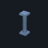</a> | **CTL-07** Jumper wires male-female 20 cm (120) | 1 | \$6.98 | [Amazon](https://www.amazon.com/dp/B0BHNM91FX) | [STEP](cad/bought/CTL-07_jumper_wire_mf.step?raw=true) · [STL](cad/bought/CTL-07_jumper_wire_mf.stl?raw=true) |
| <a href="cad/bought/LAR-02_nema17_17hs4401.stl">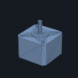</a> | **LAR-02** NEMA 17 stepper 42 Ncm 1.5 A, 38 mm (5-pack: M4, M3, M2 + 2 spare) | 1 | \$32.99 | [Amazon](https://www.amazon.com/dp/B088B756MY) | [STEP](cad/bought/LAR-02_nema17_17hs4401.step?raw=true) · [STL](cad/bought/LAR-02_nema17_17hs4401.stl?raw=true) |
| <a href="cad/bought/LAR-05_tcst2103_endstop_module.stl">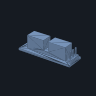</a> | **LAR-05** Optical endstop module, slot type (6-pack) | 1 | \$8.99 | [Amazon](https://www.amazon.com/dp/B0719K9Z9R) | [STEP](cad/bought/LAR-05_tcst2103_endstop_module.step?raw=true) · [STL](cad/bought/LAR-05_tcst2103_endstop_module.stl?raw=true) · [maker](https://www.vishay.com/en/product/81147/) |
| <a href="cad/bought/LAR-06_limit_switch_sealed_prewired.stl">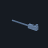</a> | **LAR-06** Roller-lever limit switch, sealed, 3 wires attached (2-pack) | 1 | \$9.88 | [Amazon](https://www.amazon.com/dp/B09VGL29HS) | [STEP](cad/bought/LAR-06_limit_switch_sealed_prewired.step?raw=true) · [STL](cad/bought/LAR-06_limit_switch_sealed_prewired.stl?raw=true) |
| <a href="cad/bought/CAM-01_arducam_b0433_imx477_usb.stl">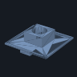</a> | **CAM-01** USB camera 12 MP IMX477, M12 mount (UVC) | 1 | \$59.99 | [Amazon](https://www.amazon.com/dp/B0C1G73QZD) | [STEP](cad/bought/CAM-01_arducam_b0433_imx477_usb.step?raw=true) · [STL](cad/bought/CAM-01_arducam_b0433_imx477_usb.stl?raw=true) |
| <a href="cad/bought/LSR-06_te_lumawise_z35_2213678_5.stl">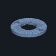</a> | **LSR-06** Solderless COB holder 13.5 mm (TE LUMAWISE Z35) | 1 | \$3.50 | [Digi-Key](https://www.digikey.com/en/products/detail/te-connectivity-amp-connectors/2213678-5/6174915) | [STEP](cad/bought/LSR-06_te_lumawise_z35_2213678_5.step?raw=true) · [STL](cad/bought/LSR-06_te_lumawise_z35_2213678_5.stl?raw=true) · [maker](https://www.te.com/) |
| <a href="cad/bought/LSR-01_citizen_clu7a3_cob.stl"></a> | **LSR-01** COB LED CRI 97, 12 V, 13.5 mm (Citizen CLU7A3) | 1 | \$5.91 | [Digi-Key](https://www.digikey.com/en/products/detail/citizen/CLU7A3-0403E1-303H7X5/17053751) | [STEP](cad/bought/LSR-01_citizen_clu7a3_cob.step?raw=true) · [STL](cad/bought/LSR-01_citizen_clu7a3_cob.stl?raw=true) |
| <a href="cad/bought/LSR-02_meanwell_nldd_350h.stl"></a> | **LSR-02** Constant-current driver 350 mA | 1 | \$5.41 | [Digi-Key](https://www.digikey.com/en/products/detail/mean-well-usa-inc/NLDD-350H/13913618) | [STEP](cad/bought/LSR-02_meanwell_nldd_350h.step?raw=true) · [STL](cad/bought/LSR-02_meanwell_nldd_350h.stl?raw=true) · [maker](https://www.meanwellusa.com/) |
| <a href="cad/bought/SPN-01_nema17_17hs08_1004s_pancake.stl">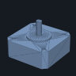</a> | **SPN-01** NEMA 17 pancake stepper 16 Ncm 1 A (direct drive) | 1 | \$11.99 | [Amazon](https://www.amazon.com/dp/B00PNEQ79Q) | [STEP](cad/bought/SPN-01_nema17_17hs08_1004s_pancake.step?raw=true) · [STL](cad/bought/SPN-01_nema17_17hs08_1004s_pancake.stl?raw=true) · [maker](https://files.omc-stepperonline.com/17HS08-1004S.STEP) |
| | **Total** | | **\$263.76** | | |
<!-- bom-electronics:end -->

## Mechanical

<!-- bom-mechanical:start -->
| | Part | Qty | Price | Buy | 3D model |
|:-:|---|:-:|--:|---|---|
|  | **FIL-01** ABS filament 1.75 mm, black, 1 kg (4 spools) | 4 | 4 × \$15.99 | [Amazon](https://www.amazon.com/dp/B0DDPSXDHG) | - |
| <a href="cad/bought/FRM-06_screws_m2_samples.stl">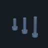</a> | **FRM-06** M2 socket screw kit, 4–25 mm, with nuts and washers (900 pcs) | 1 | \$7.58 | [Amazon](https://www.amazon.com/dp/B0DCKCN2WM) | [STEP](cad/bought/FRM-06_screws_m2_samples.step?raw=true) · [STL](cad/bought/FRM-06_screws_m2_samples.stl?raw=true) |
| <a href="cad/bought/FRM-07_screw_m3x8.stl">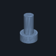</a> | **FRM-07** Socket screw kit M2/M3/M4 with nuts (820 pcs): M3 for the motors | 1 | \$9.88 | [Amazon](https://www.amazon.com/dp/B0D636MJ1N) | [STEP](cad/bought/FRM-07_screw_m3x8.step?raw=true) · [STL](cad/bought/FRM-07_screw_m3x8.stl?raw=true) |
| <a href="cad/bought/FRM-08_bearing_608_2rs.stl">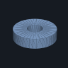</a> | **FRM-08** 608-2RS bearings (10) | 1 | \$4.99 | [Amazon](https://www.amazon.com/dp/B0CX8CDL7D) | [STEP](cad/bought/FRM-08_bearing_608_2rs.step?raw=true) · [STL](cad/bought/FRM-08_bearing_608_2rs.stl?raw=true) |
| <a href="cad/bought/LAR-01_lazy_susan_12in.stl"></a> | **LAR-01** 12 in lazy Susan bearing | 1 | \$13.99 | [Amazon](https://www.amazon.com/dp/B0CQXFVDN7) | [STEP](cad/bought/LAR-01_lazy_susan_12in.step?raw=true) · [STL](cad/bought/LAR-01_lazy_susan_12in.stl?raw=true) · [maker](https://www.mcmaster.com/1443T2) |
| <a href="cad/bought/LAR-03_gt2_belt_open_1m.stl">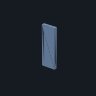</a> | **LAR-03** GT2 6 mm open belt (5 m) | 1 | \$7.59 | [Amazon](https://www.amazon.com/dp/B0BSMNZ53S) | [STEP](cad/bought/LAR-03_gt2_belt_open_1m.step?raw=true) · [STL](cad/bought/LAR-03_gt2_belt_open_1m.stl?raw=true) |
|  | **LAR-04** GT2 20T pulley 5 mm bore (5-pack) | 1 | \$3.99 | [Amazon](https://www.amazon.com/dp/B0DJQC42DT) | [STEP](cad/bought/LAR-04_gt2_pulley_20t_5mm.step?raw=true) · [STL](cad/bought/LAR-04_gt2_pulley_20t_5mm.stl?raw=true) · [open model](cad/open/LAR-04_adafruit_1253_gt2_20t_pulley_8mm_bore.step?raw=true) |
| <a href="cad/bought/TBL-02_gt2_belt_232_loop.stl"></a> | **TBL-02** GT2 6 mm closed belt 232 mm | 1 | \$8.19 | [Amazon](https://www.amazon.com/dp/B0FRFGBS6J) | [STEP](cad/bought/TBL-02_gt2_belt_232_loop.step?raw=true) · [STL](cad/bought/TBL-02_gt2_belt_232_loop.stl?raw=true) |
| <a href="cad/bought/TBL-05_bolt_m8x75_nut.stl">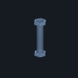</a> | **TBL-05** M8 x 75 hex bolt, partial thread + M8 nut (fixed table axle) | 1 | \$15.37 | [Amazon](https://www.amazon.com/dp/B0D83HW8ZM) | [STEP](cad/bought/TBL-05_bolt_m8x75_nut.step?raw=true) · [STL](cad/bought/TBL-05_bolt_m8x75_nut.stl?raw=true) |
| <a href="cad/bought/CAM-02_m12_lens_16mm.stl">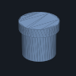</a> | **CAM-02** M12 lens 16 mm, ≥ 1/2 in format, low distortion | 1 | \$30.11 | [Amazon](https://www.amazon.com/dp/B0HJWVFD7R) | [STEP](cad/bought/CAM-02_m12_lens_16mm.step?raw=true) · [STL](cad/bought/CAM-02_m12_lens_16mm.stl?raw=true) |
| <a href="cad/bought/LSR-03_heatsink_40x40x11.stl"></a> | **LSR-03** Heatsink 40 x 40 mm (from a pack) | 1 | \$6.99 | [Amazon](https://www.amazon.com/dp/B07D4FVC61) | [STEP](cad/bought/LSR-03_heatsink_40x40x11.step?raw=true) · [STL](cad/bought/LSR-03_heatsink_40x40x11.stl?raw=true) |
| <a href="cad/bought/ENC-02_felt_9x12in.stl"></a> | **ENC-02** Black felt sheet | 1 | \$6.99 | [Amazon](https://www.amazon.com/dp/B0FXKGNV95) | [STEP](cad/bought/ENC-02_felt_9x12in.step?raw=true) · [STL](cad/bought/ENC-02_felt_9x12in.stl?raw=true) |
| <a href="cad/bought/CAL-01_ptfe_tile_50mm_3x3mm.stl">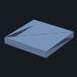</a> | **CAL-01** PTFE sheets 100 x 100 x 3 mm (2): white tile = 3 stacked 50 mm squares | 1 | \$16.99 | [Amazon](https://www.amazon.com/dp/B0F83XRXTV) | [STEP](cad/bought/CAL-01_ptfe_tile_50mm_3x3mm.step?raw=true) · [STL](cad/bought/CAL-01_ptfe_tile_50mm_3x3mm.stl?raw=true) |
| <a href="cad/bought/CAL-02_mirror_tile_50mm.stl">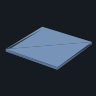</a> | **CAL-02** Glass mirror tile ~50 mm | 1 | \$11.49 | [Amazon](https://www.amazon.com/dp/B01H0ZU1QA) | [STEP](cad/bought/CAL-02_mirror_tile_50mm.step?raw=true) · [STL](cad/bought/CAL-02_mirror_tile_50mm.stl?raw=true) |
| <a href="cad/bought/CAL-04_charuco_glass_4x6in.stl"></a> | **CAL-04** ChArUco print + picture-frame glass | 1 | \$4.31 | [Amazon](https://www.amazon.com/dp/B000Y79K32) | [STEP](cad/bought/CAL-04_charuco_glass_4x6in.step?raw=true) · [STL](cad/bought/CAL-04_charuco_glass_4x6in.stl?raw=true) |
| <a href="cad/bought/TLT-02_gt2_belt_280_loop.stl"></a> | **TLT-02** GT2 6 mm closed belt 280 mm | 1 | \$7.49 | [Amazon](https://www.amazon.com/dp/B07RK1TX8C) | [STEP](cad/bought/TLT-02_gt2_belt_280_loop.step?raw=true) · [STL](cad/bought/TLT-02_gt2_belt_280_loop.stl?raw=true) |
| <a href="cad/bought/TLT-05_bolt_m8x35_nut.stl"></a> | **TLT-05** M8 x 35 hex bolts, half thread (10-pack; 2 used) | 1 | \$9.19 | [Amazon](https://www.amazon.com/dp/B08KSVMT7W) | [STEP](cad/bought/TLT-05_bolt_m8x35_nut.step?raw=true) · [STL](cad/bought/TLT-05_bolt_m8x35_nut.stl?raw=true) |
| <a href="cad/bought/SCN-01_mounting_putty_blob.stl">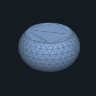</a> | **SCN-01** Mounting putty 2 oz | 1 | \$2.33 | [Amazon](https://www.amazon.com/dp/B003LZMHIY) | [STEP](cad/bought/SCN-01_mounting_putty_blob.step?raw=true) · [STL](cad/bought/SCN-01_mounting_putty_blob.stl?raw=true) |
| | **Total** | | **\$231.43** | | |
<!-- bom-mechanical:end -->

## Printed parts

Black ABS (acrylonitrile butadiene styrene) on an enclosed printer, ≈ 2.7 kg, half of it the nine deck tiles ([print list](cad/PRINT.md), [deck map](phases/03-frame/deck-map.svg)). Print the tolerance coupon (PLAN-01) first: it sets the M2 pilot size. Whole machine: [assembly STEP](cad/assembly/opengonio_assembly.step) (Onshape, FreeCAD) · [glTF](exports/cad/opengonio_assembly.glb) (Blender, web).

<!-- bom-printed:start -->
| | Part | Stage | Download |
|:-:|---|---|---|
| <a href="phases/00-plan/3d/PLAN-01_tolerance_coupon.stl">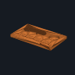</a> | **PLAN-01** tolerance coupon | [00 Plan](phases/00-plan/) | [STL](phases/00-plan/3d/PLAN-01_tolerance_coupon.stl?raw=true) · [STEP](phases/00-plan/3d/PLAN-01_tolerance_coupon.step?raw=true) |
| <a href="phases/01-power/3d/PWR-18_power_plate.stl">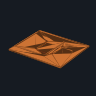</a> | **PWR-18** power plate | [01 Power](phases/01-power/) | [STL](phases/01-power/3d/PWR-18_power_plate.stl?raw=true) · [STEP](phases/01-power/3d/PWR-18_power_plate.step?raw=true) |
| <a href="phases/02-controller/3d/CTL-10a_button_panel.stl">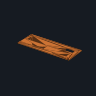</a> | **CTL-10a** button panel | [02 Controller and buttons](phases/02-controller/) | [STL](phases/02-controller/3d/CTL-10a_button_panel.stl?raw=true) · [STEP](phases/02-controller/3d/CTL-10a_button_panel.step?raw=true) |
| <a href="phases/02-controller/3d/CTL-10b_controller_tray.stl">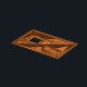</a> | **CTL-10b** controller tray | [02 Controller and buttons](phases/02-controller/) | [STL](phases/02-controller/3d/CTL-10b_controller_tray.stl?raw=true) · [STEP](phases/02-controller/3d/CTL-10b_controller_tray.step?raw=true) |
| <a href="phases/03-frame/3d/FRM-01a_deck_tile_SW.stl">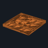</a> | **FRM-01a** deck tile SW | [03 Frame](phases/03-frame/) | [STL](phases/03-frame/3d/FRM-01a_deck_tile_SW.stl?raw=true) · [STEP](phases/03-frame/3d/FRM-01a_deck_tile_SW.step?raw=true) |
| <a href="phases/03-frame/3d/FRM-01b_deck_tile_S.stl">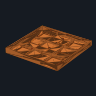</a> | **FRM-01b** deck tile S | [03 Frame](phases/03-frame/) | [STL](phases/03-frame/3d/FRM-01b_deck_tile_S.stl?raw=true) · [STEP](phases/03-frame/3d/FRM-01b_deck_tile_S.step?raw=true) |
| <a href="phases/03-frame/3d/FRM-01c_deck_tile_SE.stl">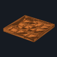</a> | **FRM-01c** deck tile SE | [03 Frame](phases/03-frame/) | [STL](phases/03-frame/3d/FRM-01c_deck_tile_SE.stl?raw=true) · [STEP](phases/03-frame/3d/FRM-01c_deck_tile_SE.step?raw=true) |
| <a href="phases/03-frame/3d/FRM-01d_deck_tile_W.stl">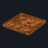</a> | **FRM-01d** deck tile W | [03 Frame](phases/03-frame/) | [STL](phases/03-frame/3d/FRM-01d_deck_tile_W.stl?raw=true) · [STEP](phases/03-frame/3d/FRM-01d_deck_tile_W.step?raw=true) |
| <a href="phases/03-frame/3d/FRM-01e_deck_tile_C.stl">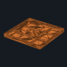</a> | **FRM-01e** deck tile C | [03 Frame](phases/03-frame/) | [STL](phases/03-frame/3d/FRM-01e_deck_tile_C.stl?raw=true) · [STEP](phases/03-frame/3d/FRM-01e_deck_tile_C.step?raw=true) |
| <a href="phases/03-frame/3d/FRM-01f_deck_tile_E.stl">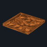</a> | **FRM-01f** deck tile E | [03 Frame](phases/03-frame/) | [STL](phases/03-frame/3d/FRM-01f_deck_tile_E.stl?raw=true) · [STEP](phases/03-frame/3d/FRM-01f_deck_tile_E.step?raw=true) |
| <a href="phases/03-frame/3d/FRM-01g_deck_tile_NW.stl">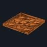</a> | **FRM-01g** deck tile NW | [03 Frame](phases/03-frame/) | [STL](phases/03-frame/3d/FRM-01g_deck_tile_NW.stl?raw=true) · [STEP](phases/03-frame/3d/FRM-01g_deck_tile_NW.step?raw=true) |
| <a href="phases/03-frame/3d/FRM-01h_deck_tile_N.stl">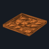</a> | **FRM-01h** deck tile N | [03 Frame](phases/03-frame/) | [STL](phases/03-frame/3d/FRM-01h_deck_tile_N.stl?raw=true) · [STEP](phases/03-frame/3d/FRM-01h_deck_tile_N.step?raw=true) |
| <a href="phases/03-frame/3d/FRM-01i_deck_tile_NE.stl">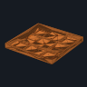</a> | **FRM-01i** deck tile NE | [03 Frame](phases/03-frame/) | [STL](phases/03-frame/3d/FRM-01i_deck_tile_NE.stl?raw=true) · [STEP](phases/03-frame/3d/FRM-01i_deck_tile_NE.step?raw=true) |
| <a href="phases/03-frame/3d/FRM-02a_outrigger_bar_1.stl"></a> | **FRM-02a** outrigger bar 1 | [03 Frame](phases/03-frame/) | [STL](phases/03-frame/3d/FRM-02a_outrigger_bar_1.stl?raw=true) · [STEP](phases/03-frame/3d/FRM-02a_outrigger_bar_1.step?raw=true) |
| <a href="phases/03-frame/3d/FRM-02b_outrigger_bar_2.stl">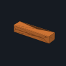</a> | **FRM-02b** outrigger bar 2 | [03 Frame](phases/03-frame/) | [STL](phases/03-frame/3d/FRM-02b_outrigger_bar_2.stl?raw=true) · [STEP](phases/03-frame/3d/FRM-02b_outrigger_bar_2.step?raw=true) |
| <a href="phases/03-frame/3d/FRM-02c_scan_post_bar_1.stl"></a> | **FRM-02c** scan post bar 1 | [03 Frame](phases/03-frame/) | [STL](phases/03-frame/3d/FRM-02c_scan_post_bar_1.stl?raw=true) · [STEP](phases/03-frame/3d/FRM-02c_scan_post_bar_1.step?raw=true) |
| <a href="phases/03-frame/3d/FRM-02d_scan_post_bar_2.stl">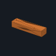</a> | **FRM-02d** scan post bar 2 | [03 Frame](phases/03-frame/) | [STL](phases/03-frame/3d/FRM-02d_scan_post_bar_2.stl?raw=true) · [STEP](phases/03-frame/3d/FRM-02d_scan_post_bar_2.step?raw=true) |
| <a href="phases/03-frame/3d/FRM-09c_protractor_segment.stl"></a> | **FRM-09c** protractor segment | [03 Frame](phases/03-frame/) | [STL](phases/03-frame/3d/FRM-09c_protractor_segment.stl?raw=true) · [STEP](phases/03-frame/3d/FRM-09c_protractor_segment.step?raw=true) |
| <a href="phases/03-frame/3d/FRM-09d_bar_saddle.stl">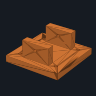</a> | **FRM-09d** bar saddle | [03 Frame](phases/03-frame/) | [STL](phases/03-frame/3d/FRM-09d_bar_saddle.stl?raw=true) · [STEP](phases/03-frame/3d/FRM-09d_bar_saddle.step?raw=true) |
| <a href="phases/03-frame/3d/FRM-09e_post_socket.stl">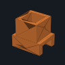</a> | **FRM-09e** post socket | [03 Frame](phases/03-frame/) | [STL](phases/03-frame/3d/FRM-09e_post_socket.stl?raw=true) · [STEP](phases/03-frame/3d/FRM-09e_post_socket.step?raw=true) |
| <a href="phases/03-frame/3d/FRM-09f_end_foot.stl">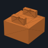</a> | **FRM-09f** end foot | [03 Frame](phases/03-frame/) | [STL](phases/03-frame/3d/FRM-09f_end_foot.stl?raw=true) · [STEP](phases/03-frame/3d/FRM-09f_end_foot.step?raw=true) |
| <a href="phases/03-frame/3d/FRM-09h_camera_pillar.stl">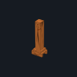</a> | **FRM-09h** camera pillar | [03 Frame](phases/03-frame/) | [STL](phases/03-frame/3d/FRM-09h_camera_pillar.stl?raw=true) · [STEP](phases/03-frame/3d/FRM-09h_camera_pillar.step?raw=true) |
| <a href="phases/03-frame/3d/FRM-09i_bar_coupler.stl">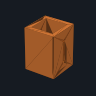</a> | **FRM-09i** bar coupler | [03 Frame](phases/03-frame/) | [STL](phases/03-frame/3d/FRM-09i_bar_coupler.stl?raw=true) · [STEP](phases/03-frame/3d/FRM-09i_bar_coupler.step?raw=true) |
| <a href="phases/04-light-arm/3d/LAR-08a_rim_segment.stl">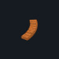</a> | **LAR-08a** rim segment | [04 Light arm (M4)](phases/04-light-arm/) | [STL](phases/04-light-arm/3d/LAR-08a_rim_segment.stl?raw=true) · [STEP](phases/04-light-arm/3d/LAR-08a_rim_segment.step?raw=true) |
| <a href="phases/04-light-arm/3d/LAR-08b_ring_motor_mount.stl">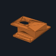</a> | **LAR-08b** ring motor mount | [04 Light arm (M4)](phases/04-light-arm/) | [STL](phases/04-light-arm/3d/LAR-08b_ring_motor_mount.stl?raw=true) · [STEP](phases/04-light-arm/3d/LAR-08b_ring_motor_mount.step?raw=true) |
| <a href="phases/04-light-arm/3d/LAR-08c_arm_segment.stl">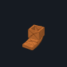</a> | **LAR-08c** arm segment | [04 Light arm (M4)](phases/04-light-arm/) | [STL](phases/04-light-arm/3d/LAR-08c_arm_segment.stl?raw=true) · [STEP](phases/04-light-arm/3d/LAR-08c_arm_segment.step?raw=true) |
| <a href="phases/04-light-arm/3d/LAR-08e_cross_clamp.stl">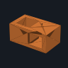</a> | **LAR-08e** cross clamp | [04 Light arm (M4)](phases/04-light-arm/) | [STL](phases/04-light-arm/3d/LAR-08e_cross_clamp.stl?raw=true) · [STEP](phases/04-light-arm/3d/LAR-08e_cross_clamp.step?raw=true) |
| <a href="phases/04-light-arm/3d/LAR-08f_upright_bar.stl">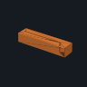</a> | **LAR-08f** upright bar | [04 Light arm (M4)](phases/04-light-arm/) | [STL](phases/04-light-arm/3d/LAR-08f_upright_bar.stl?raw=true) · [STEP](phases/04-light-arm/3d/LAR-08f_upright_bar.step?raw=true) |
| <a href="phases/04-light-arm/3d/LAR-08g_arm_bar.stl">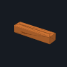</a> | **LAR-08g** arm bar | [04 Light arm (M4)](phases/04-light-arm/) | [STL](phases/04-light-arm/3d/LAR-08g_arm_bar.stl?raw=true) · [STEP](phases/04-light-arm/3d/LAR-08g_arm_bar.step?raw=true) |
| <a href="phases/05-table/3d/TBL-07a_table_drum.stl">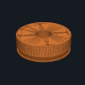</a> | **TBL-07a** table drum | [05 Table (M3)](phases/05-table/) | [STL](phases/05-table/3d/TBL-07a_table_drum.stl?raw=true) · [STEP](phases/05-table/3d/TBL-07a_table_drum.step?raw=true) |
| <a href="phases/05-table/3d/TBL-07b_home_flag.stl">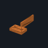</a> | **TBL-07b** home flag | [05 Table (M3)](phases/05-table/) | [STL](phases/05-table/3d/TBL-07b_home_flag.stl?raw=true) · [STEP](phases/05-table/3d/TBL-07b_home_flag.step?raw=true) |
| <a href="phases/05-table/3d/TBL-07c_table_motor_bracket.stl"></a> | **TBL-07c** table motor bracket | [05 Table (M3)](phases/05-table/) | [STL](phases/05-table/3d/TBL-07c_table_motor_bracket.stl?raw=true) · [STEP](phases/05-table/3d/TBL-07c_table_motor_bracket.step?raw=true) |
| <a href="phases/05-table/3d/TBL-07d_table_post.stl"></a> | **TBL-07d** table post | [05 Table (M3)](phases/05-table/) | [STL](phases/05-table/3d/TBL-07d_table_post.stl?raw=true) · [STEP](phases/05-table/3d/TBL-07d_table_post.step?raw=true) |
| <a href="phases/05-table/3d/TBL-07f_spacers.stl"></a> | **TBL-07f** spacers | [05 Table (M3)](phases/05-table/) | [STL](phases/05-table/3d/TBL-07f_spacers.stl?raw=true) · [STEP](phases/05-table/3d/TBL-07f_spacers.step?raw=true) |
| <a href="phases/05-table/3d/TBL-07g_endstop_riser.stl"></a> | **TBL-07g** endstop riser | [05 Table (M3)](phases/05-table/) | [STL](phases/05-table/3d/TBL-07g_endstop_riser.stl?raw=true) · [STEP](phases/05-table/3d/TBL-07g_endstop_riser.step?raw=true) |
| <a href="phases/05-table/3d/TBL-07h_table_flag.stl"></a> | **TBL-07h** table flag | [05 Table (M3)](phases/05-table/) | [STL](phases/05-table/3d/TBL-07h_table_flag.stl?raw=true) · [STEP](phases/05-table/3d/TBL-07h_table_flag.step?raw=true) |
| <a href="phases/06-camera-light/3d/CAM-03a_aperture_stop_f8.stl"></a> | **CAM-03a** aperture stop f8 | [06 Camera and light](phases/06-camera-light/) | [STL](phases/06-camera-light/3d/CAM-03a_aperture_stop_f8.stl?raw=true) · [STEP](phases/06-camera-light/3d/CAM-03a_aperture_stop_f8.step?raw=true) |
| <a href="phases/06-camera-light/3d/CAM-03b_camera_plate.stl"></a> | **CAM-03b** camera plate | [06 Camera and light](phases/06-camera-light/) | [STL](phases/06-camera-light/3d/CAM-03b_camera_plate.stl?raw=true) · [STEP](phases/06-camera-light/3d/CAM-03b_camera_plate.step?raw=true) |
| <a href="phases/06-camera-light/3d/LSR-05a_lamp_tube.stl"></a> | **LSR-05a** lamp tube | [06 Camera and light](phases/06-camera-light/) | [STL](phases/06-camera-light/3d/LSR-05a_lamp_tube.stl?raw=true) · [STEP](phases/06-camera-light/3d/LSR-05a_lamp_tube.step?raw=true) |
| <a href="phases/06-camera-light/3d/LSR-05b_lamp_cap.stl"></a> | **LSR-05b** lamp cap | [06 Camera and light](phases/06-camera-light/) | [STL](phases/06-camera-light/3d/LSR-05b_lamp_cap.stl?raw=true) · [STEP](phases/06-camera-light/3d/LSR-05b_lamp_cap.step?raw=true) |
| <a href="phases/07-calibrate/3d/CAL-06a_ptfe_holder.stl"></a> | **CAL-06a** ptfe holder | [07 Calibrate → game material](phases/07-calibrate/) | [STL](phases/07-calibrate/3d/CAL-06a_ptfe_holder.stl?raw=true) · [STEP](phases/07-calibrate/3d/CAL-06a_ptfe_holder.step?raw=true) |
| <a href="phases/07-calibrate/3d/CAL-06b_mirror_holder.stl"></a> | **CAL-06b** mirror holder | [07 Calibrate → game material](phases/07-calibrate/) | [STL](phases/07-calibrate/3d/CAL-06b_mirror_holder.stl?raw=true) · [STEP](phases/07-calibrate/3d/CAL-06b_mirror_holder.step?raw=true) |
| <a href="phases/07-calibrate/3d/CAL-06c_ball_holder.stl"></a> | **CAL-06c** ball holder | [07 Calibrate → game material](phases/07-calibrate/) | [STL](phases/07-calibrate/3d/CAL-06c_ball_holder.stl?raw=true) · [STEP](phases/07-calibrate/3d/CAL-06c_ball_holder.step?raw=true) |
| <a href="phases/07-calibrate/3d/ENC-04a_dowel_socket.stl"></a> | **ENC-04a** dowel socket | [07 Calibrate → game material](phases/07-calibrate/) | [STL](phases/07-calibrate/3d/ENC-04a_dowel_socket.stl?raw=true) · [STEP](phases/07-calibrate/3d/ENC-04a_dowel_socket.step?raw=true) |
| <a href="phases/08-tilt/3d/TLT-07a_tilt_yoke.stl"></a> | **TLT-07a** tilt yoke | [08 Tilt (M2)](phases/08-tilt/) | [STL](phases/08-tilt/3d/TLT-07a_tilt_yoke.stl?raw=true) · [STEP](phases/08-tilt/3d/TLT-07a_tilt_yoke.step?raw=true) |
| <a href="phases/08-tilt/3d/TLT-07b_pulley_100T.stl"></a> | **TLT-07b** pulley 100T | [08 Tilt (M2)](phases/08-tilt/) | [STL](phases/08-tilt/3d/TLT-07b_pulley_100T.stl?raw=true) · [STEP](phases/08-tilt/3d/TLT-07b_pulley_100T.step?raw=true) |
| <a href="phases/08-tilt/3d/TLT-07c_tilt_cradle.stl"></a> | **TLT-07c** tilt cradle | [08 Tilt (M2)](phases/08-tilt/) | [STL](phases/08-tilt/3d/TLT-07c_tilt_cradle.stl?raw=true) · [STEP](phases/08-tilt/3d/TLT-07c_tilt_cradle.step?raw=true) |
| <a href="phases/09-spin/3d/SPN-07a_spin_platter.stl"></a> | **SPN-07a** spin platter | [09 Spin (M1)](phases/09-spin/) | [STL](phases/09-spin/3d/SPN-07a_spin_platter.stl?raw=true) · [STEP](phases/09-spin/3d/SPN-07a_spin_platter.step?raw=true) |
| <a href="phases/10-color/3d/MSK-06a_led_ring.stl"></a> | **MSK-06a** led ring | [10 Colour add-ons (optional)](phases/10-color/) | [STL](phases/10-color/3d/MSK-06a_led_ring.stl?raw=true) · [STEP](phases/10-color/3d/MSK-06a_led_ring.step?raw=true) |
| <a href="phases/10-color/3d/MSK-06b_led_mast.stl"></a> | **MSK-06b** led mast | [10 Colour add-ons (optional)](phases/10-color/) | [STL](phases/10-color/3d/MSK-06b_led_mast.stl?raw=true) · [STEP](phases/10-color/3d/MSK-06b_led_mast.step?raw=true) |
| <a href="phases/10-color/3d/SPC-03a_spectral_tube.stl"></a> | **SPC-03a** spectral tube | [10 Colour add-ons (optional)](phases/10-color/) | [STL](phases/10-color/3d/SPC-03a_spectral_tube.stl?raw=true) · [STEP](phases/10-color/3d/SPC-03a_spectral_tube.step?raw=true) |
| <a href="phases/11-scan-capture/3d/SCN-03a_riser_20.stl"></a> | **SCN-03a** riser 20 | [11 3D scan: capture](phases/11-scan-capture/) | [STL](phases/11-scan-capture/3d/SCN-03a_riser_20.stl?raw=true) · [STEP](phases/11-scan-capture/3d/SCN-03a_riser_20.step?raw=true) |
| <a href="phases/11-scan-capture/3d/SCN-03b_riser_40.stl"></a> | **SCN-03b** riser 40 | [11 3D scan: capture](phases/11-scan-capture/) | [STL](phases/11-scan-capture/3d/SCN-03b_riser_40.stl?raw=true) · [STEP](phases/11-scan-capture/3d/SCN-03b_riser_40.step?raw=true) |
| <a href="phases/11-scan-capture/3d/SCN-03c_riser_60.stl"></a> | **SCN-03c** riser 60 | [11 3D scan: capture](phases/11-scan-capture/) | [STL](phases/11-scan-capture/3d/SCN-03c_riser_60.stl?raw=true) · [STEP](phases/11-scan-capture/3d/SCN-03c_riser_60.step?raw=true) |
| <a href="phases/11-scan-capture/3d/SCN-03d_scan_camera_plate_15.stl"></a> | **SCN-03d** scan camera plate 15 | [11 3D scan: capture](phases/11-scan-capture/) | [STL](phases/11-scan-capture/3d/SCN-03d_scan_camera_plate_15.stl?raw=true) · [STEP](phases/11-scan-capture/3d/SCN-03d_scan_camera_plate_15.step?raw=true) |
| <a href="phases/15-standalone/3d/STA-07a_pi_zero_mount.stl"></a> | **STA-07a** pi zero mount | [15 Standalone (no laptop)](phases/15-standalone/) | [STL](phases/15-standalone/3d/STA-07a_pi_zero_mount.stl?raw=true) · [STEP](phases/15-standalone/3d/STA-07a_pi_zero_mount.step?raw=true) |
<!-- bom-printed:end -->

## Tools

<!-- bom-tools:start -->
| Tool | Price | Buy |
|---|--:|---|
| **TLS-01** Enclosed FDM 3D printer for ABS (Elegoo Centauri 2) | \$279.00 | [Amazon](https://www.amazon.com/dp/B0GZYZY956) |
| **TLS-02** Screwdriver set (Phillips #1/#2 + flat 2–3 mm) | \$9.99 | [Amazon](https://www.amazon.com/dp/B07RFD9JWZ) |
| **TLS-03** Hex keys 1.5 / 2 / 2.5 / 3 / 4 mm | \$9.99 | [Amazon](https://www.amazon.com/dp/B0CJBRYQF3) |
| **TLS-04** Wire stripper / cutter 10–24 AWG | \$10.49 | [Amazon](https://www.amazon.com/dp/B07TS6KCXD) |
| **TLS-05** Multimeter with temperature probe | \$34.99 | [Amazon](https://www.amazon.com/dp/B071JL6LLL) |
| **TLS-06** Digital calipers 150 mm | \$14.59 | [Amazon](https://www.amazon.com/dp/B0D2386QN9) |
| **TLS-07** Tape measure 3 m (metric) + phone level app | \$1.48 | [Amazon](https://www.amazon.com/dp/B0BRFTX359) |
| **TLS-08** Inkjet printer, US Letter, prints at 100 % | \$49.99 | [Amazon](https://www.amazon.com/dp/B0GKJZ864R) |
| **TLS-09** CA glue, double-sided tape, utility knife, 400-grit sandpaper | \$29.28 | [Amazon](https://www.amazon.com/dp/B00I4CWHD4) |
| **TLS-10** 13 mm spanner (or an adjustable wrench) | \$7.00 | [Amazon](https://www.amazon.com/dp/B00Q01OBLC) |
| **TLS-11** Printer paper, Letter, 500 sheets | \$6.97 | [Amazon](https://www.amazon.com/dp/B01FV0F8H8) |
| **LAR-09** Laser module class 2 (650 nm, < 1 mW); mirror = one CAL-02 tile | \$15.99 | [Amazon](https://www.amazon.com/dp/B00ZR80S9S) |
| **Total** (kept after the build; not in the machine cap) | **\$469.76** | |
<!-- bom-tools:end -->

## Wiring

<!-- wiring:start -->


Every connection, pin by pin. No solder, no crimps: screw terminals, lever connectors (WAGO 221), plug-in leads and jumper wires. Source: [`docs/wiring.yaml`](docs/wiring.yaml) (`make build` writes this section; `make check` compares it with the firmware). **Press the e-stop and unplug the wall adapter before touching any terminal.** Step by step with pictures: [wiring guide](docs/wiring.html); the first wires drawn as the parts sit on the bench: [power wiring walkthrough](docs/power.html), then the [controller walkthrough](docs/controller.html), then the [machine walkthrough](docs/machine.html).

**Jump to:** [Power: wall adapter, jack, e-stop](#1--power-wall-adapter-jack-e-stop) · [Motor power: e-stop → limit switch → SKR Pico](#2--motor-power-e-stop--limit-switch--skr-pico) · [SKR Pico: motors](#3--skr-pico-motors) · [SKR Pico: endstops (home switches)](#4--skr-pico-endstops-home-switches) · [Lamp (white COB)](#5--lamp-white-cob) · [Hub: keypads and motor-power sense](#6--hub-keypads-and-motor-power-sense) · [USB data](#7--usb-data) · [Optional add-ons](#8--optional-add-ons) · [Standalone station (no laptop, optional)](#9--standalone-station-no-laptop-optional) · [Not wired: colour LED bank](#10--not-wired-colour-led-bank) · [SKR Pico port map](#skr-pico-port-map) · [ESP32-S3 header map](#esp32-s3-header-map)

### 1 · Power: wall adapter, jack, e-stop

*Stage 01.* The adapter stays outside the machine and goes into the wall **last** (M06; before that only for the jack check in M04.2). 18 AWG (PWR-15) red for `+`, black for `−`. Strip 8 mm for screw terminals, 11 mm for lever connectors; twist the strands; tug-test every wire. On the BAOMAIN e-stop the NC contact is terminals 1 and 2 (NO = 3 and 4): check with the meter, 1–2 beep with the button released and open when it is pressed. Either gap under a terminal screw is the same terminal.


| # | From | To | Wire | Notes |
|---:|---|---|---|---|
| 1 | **24 V wall adapter (PWR-30)** · round 24 V plug | **Screw-terminal jack (with PWR-30)** · socket | the adapter's own cable | push fully in; the wall plug stays out (except the jack check in M04.2) until M06 |
| 2 | **Screw-terminal jack (with PWR-30)** · + | **E-stop box (PWR-28)** · NC 1 | 18 AWG red | NC contact, not NO |
| 3 | **Screw-terminal jack (with PWR-30)** · − | **Lever connector MOT− (3-way, on the tray)** · 1 | 18 AWG black (the whole run to the tray) | ground never goes through the e-stop |
| 4 | **Lever connector MOT− (3-way, on the tray)** · 3 | **SKR Pico (CTL-01)** · POWER GND | 10 cm 18 AWG black offcut | from M08.3 |

**Check:** Adapter unplugged, e-stop released: continuity jack + to e-stop NC 2 (beep); press the e-stop: open. · Jack + to jack −: OL (no short).

### 2 · Motor power: e-stop → limit switch → SKR Pico

*Stage 01–04.* One + line. Until M14.1 a red wire runs from e-stop NC 2 straight to MOT+; M14.1 cuts that run beside the limit switch and splices the switch in with two 221-2401s, so its own leads only need to reach the run (their length is not on the listing). The switch has its own wires: find them with the meter first (COM–NC beeps with the lever untouched and opens when the lever is pressed; on the units bought black = COM, grey = NC, blue = NO). Press the e-stop before touching any terminal.


| # | From | To | Wire | Notes |
|---:|---|---|---|---|
| 1 | **E-stop box (PWR-28)** · NC 2 | **Splice A, e-stop side (WAGO 221-2401)** · red in | 18 AWG red (the red run, e-stop part) | stage 04 (M14.1) cuts the run beside the switch; before that it runs on to MOT+ 1 |
| 2 | **Limit switch, over-travel (LAR-06)** · black (COM) | **Splice A, e-stop side (WAGO 221-2401)** · black | the switch's own wire | 11 mm stripped |
| 3 | **Limit switch, over-travel (LAR-06)** · grey (NC) | **Splice B, tray side (WAGO 221-2401)** · grey | the switch's own wire | connected to COM while the lever is untouched |
| 4 | **Splice B, tray side (WAGO 221-2401)** · red out | **Lever connector MOT+ (3-way, on the tray)** · 1 | 18 AWG red (the red run, tray part) |  |
| 5 | **Limit switch, over-travel (LAR-06)** · blue (NO) | **Blue-wire cap (WAGO 221-2401)** · blue | the switch's own wire | unused: alone in a 221-2401 so the bare end is covered |
| 6 | **Lever connector MOT+ (3-way, on the tray)** · 3 | **SKR Pico (CTL-01)** · POWER 12/24V | 10 cm 18 AWG red offcut | from M08.3 |

**Check:** Adapter unplugged: continuity e-stop NC 2 to MOT+ (beep); press the limit switch lever: open. · Live (M06, M14.1): adapter in, e-stop released, DC volts MOT+ to MOT− ≈ +24 V; e-stop pressed or lever pressed: 0 V.

### 3 · SKR Pico: motors

*Stage 02–09.* Motor sockets are 4-pin JST-XH 2.54 mm. Pins 1–4 = `2B 1B 1A 2A` (pin diagram, left to right). The schematic puts one driver coil on pins 1 + 4 (`2B`, `2A`) and the other on pins 2 + 3 (`1B`, `1A`). The 5-pack cables plug straight in. Check with the motor plugged in: meter on Ω at the plug's back, 1–4 and 2–3 each read a few ohms. Buzzing without turning = coil pairs crossed (move plug contacts until that check passes); wrong direction = `$3` in software, not wiring.


| # | From | To | Wire | Notes |
|---:|---|---|---|---|
| 1 | **M4 motor, light arm (LAR-02)** · 6-pin socket | **SKR Pico (CTL-01)** · X pins 1–4 (2B 1B 1A 2A) | 5-pack cable (1 m) | grblHAL X · stage 04 |
| 2 | **M3 motor, table (TBL-01)** · 6-pin socket | **SKR Pico (CTL-01)** · Y pins 1–4 (2B 1B 1A 2A) | 5-pack cable (1 m) | grblHAL Y · stage 05 |
| 3 | **M2 motor, tilt (TLT-01)** · 6-pin socket | **SKR Pico (CTL-01)** · Z1 pins 1–4 (2B 1B 1A 2A) | 5-pack cable (1 m) | grblHAL Z · stage 08 (Z2 is the same driver: leave empty) |
| 4 | **M1 pancake, spin (SPN-01)** · coil pair 1 (2 bare leads) | **Lever connectors (WAGO 221-412 / 415)** · pair 1 (2 × 221-412) | motor leads, 11 mm stripped, folded double | pancake has bare leads: find the pairs first (M27.1) |
| 5 | **Lever connectors (WAGO 221-412 / 415)** · pair 1 (2 × 221-412) | **SKR Pico (CTL-01)** · E pin 1 (2B) + E pin 4 (2A) | spare 5-pack cable (6-pin plug cut off): the wires in plug pins 1 and 4 | driver coil 2B / 2A |
| 6 | **M1 pancake, spin (SPN-01)** · coil pair 2 (2 bare leads) | **Lever connectors (WAGO 221-412 / 415)** · pair 2 (221-412 + 221-415) | motor leads, 11 mm stripped, folded double |  |
| 7 | **Lever connectors (WAGO 221-412 / 415)** · pair 2 (221-412 + 221-415) | **SKR Pico (CTL-01)** · E pins 2–3 (1B 1A) | same cable: the wires in plug pins 2 and 3 | driver coil 1B / 1A · grblHAL A · stage 09 |

### 4 · SKR Pico: endstops (home switches)

*Stage 02–09.* STOP ports are 3-pin JST-XH: pin 1 signal, pin 2 GND, pin 3 5 V. Leads: 3 CTL-06 pre-crimped wires in a 3-pin XH housing at the board end. At the module, put each wire on the pin with the matching printed label (S/OUT, G/GND, V/VCC): the module's pin order may differ from the board's. Before plugging in, meter the module's V pin to STOP pin 3 (beep). The SKR Pico buffers these inputs, so the module's 5 V signal is safe.


| # | From | To | Wire | Notes |
|---:|---|---|---|---|
| 1 | **M4 endstop (LAR-05)** · S / G / V (by label) | **SKR Pico (CTL-01)** · X-STOP pins 1–3 (IO4 GND 5V) | CTL-06 lead | M4 home at 20° · `Pn:X` |
| 2 | **M3 endstop (TBL-04)** · S / G / V (by label) | **SKR Pico (CTL-01)** · Y-STOP pins 1–3 (IO3 GND 5V) | CTL-06 lead | M3 home · `Pn:Y` |
| 3 | **M2 endstop (TLT-04)** · S / G / V (by label) | **SKR Pico (CTL-01)** · Z-STOP pins 1–3 (IO25 GND 5V) | CTL-06 lead | M2 home · `Pn:Z` |
| 4 | **M1 endstop (SPN-04)** · S / G / V (by label) | **SKR Pico (CTL-01)** · E0-STOP pins 1–3 (IO16 GND 5V) | CTL-06 lead | M1 home · `Pn:A` (needs a 4-axis grblHAL build) |

### 5 · Lamp (white COB)

*Stage 06.* The driver sits pins-up in its frame on the tray; female jumper ends push onto its pins. A cut jumper = one female end, the other end stripped. HE is a low-side switch: its `IO23` terminal is the switched `−`.


| # | From | To | Wire | Notes |
|---:|---|---|---|---|
| 1 | **Lamp driver NLDD-350H (LSR-02)** · +Vin | **SKR Pico (CTL-01)** · HE 12/24V | cut M-F jumper, bare end under the HE screw | HE `+`: always at motor-power voltage |
| 2 | **Lamp driver NLDD-350H (LSR-02)** · −Vin | **SKR Pico (CTL-01)** · HE IO23 | cut M-F jumper, bare end under the HE screw | HE `−`, switched: `M62 P4` on / `M63 P4` off (check with `$PINS`) |
| 3 | **Lamp driver NLDD-350H (LSR-02)** · +Vo | **COB lamp in holder (LSR-01 + LSR-06)** · red (+) lead | chain of 5 M-F jumpers + lever connector at the lamp | slack for 20–324° of arm travel |
| 4 | **Lamp driver NLDD-350H (LSR-02)** · −Vo | **COB lamp in holder (LSR-01 + LSR-06)** · black (−) lead | chain of 5 M-F jumpers + lever connector |  |
| 5 | **Lamp driver NLDD-350H (LSR-02)** · DIM | — | not connected | no dimming: on/off only |

### 6 · Hub: keypads and motor-power sense

*Stage 02.* ESP32-S3-DevKitC-1, header pin numbers from Espressif's user guide and pin-layout drawing: J1 = the long header on the side of the connector marked UART, J3 = the side of the connector marked USB; pin 1 at the antenna end, pins 21–22 next to the USB-C connectors. The hub is mounted upside down (pins up), which mirrors the top-view drawing: wire it before mounting, or count pins from the antenna end; clones don't always print labels underneath. Male–female jumpers (CTL-07). The keypads' 5-pin tails: find the common pin with the meter first (M07.2). Both keypad commons share one GND pin through a 3-way lever connector, so a GND pin stays free for the Pi (stage 15).


| # | From | To | Wire | Notes |
|---:|---|---|---|---|
| 1 | **Keypad A (CTL-05)** · common | **Lever connector keypad GND (3-way)** · 1 | M-F jumper, female end cut and stripped | fold the stripped end double in the lever connector |
| 2 | **Keypad A (CTL-05)** · key 1 | **ESP32-S3 hub (CTL-02)** · J1-4 (GPIO4) | M-F jumper | HOME |
| 3 | **Keypad A (CTL-05)** · key 2 | **ESP32-S3 hub (CTL-02)** · J1-5 (GPIO5) | M-F jumper | START |
| 4 | **Keypad A (CTL-05)** · key 3 | **ESP32-S3 hub (CTL-02)** · J1-6 (GPIO6) | M-F jumper | STOP |
| 5 | **Keypad A (CTL-05)** · key 4 | **ESP32-S3 hub (CTL-02)** · J1-7 (GPIO7) | M-F jumper | LIGHT |
| 6 | **Keypad B (CTL-05)** · common | **Lever connector keypad GND (3-way)** · 2 | M-F jumper, female end cut and stripped | fold double |
| 7 | **Lever connector keypad GND (3-way)** · 3 | **ESP32-S3 hub (CTL-02)** · J1-22 (GND) | M-F jumper, male end cut and stripped | GND · frees J3-1 for the Pi (stage 15) |
| 8 | **Keypad B (CTL-05)** · key 1 | **ESP32-S3 hub (CTL-02)** · J1-8 (GPIO15) | M-F jumper | NEXT |
| 9 | **Keypad B (CTL-05)** · key 2 | **ESP32-S3 hub (CTL-02)** · J1-9 (GPIO16) | M-F jumper | PAUSE (stops after the current pose) |
| 10 | **Keypad B (CTL-05)** · key 3, key 4 | — | not connected | spare keys |
| 11 | **Lever connector MOT+ (3-way, on the tray)** · 2 | **Opto module (PWR-10)** · IN+ | short 18 AWG red | 24 V module; its resistor is on board |
| 12 | **Lever connector MOT− (3-way, on the tray)** · 2 | **Opto module (PWR-10)** · IN− | short 18 AWG black | 8 mm under the module screw, 11 mm in the lever connector |
| 13 | **Opto module (PWR-10)** · VCC | **ESP32-S3 hub (CTL-02)** · J1-1 (3V3) | M-F jumper | 3V3 (not 5 V: the GPIO is 3.3 V) |
| 14 | **Opto module (PWR-10)** · GND | **ESP32-S3 hub (CTL-02)** · J3-21 (GND) | M-F jumper | GND |
| 15 | **Opto module (PWR-10)** · OUT | **ESP32-S3 hub (CTL-02)** · J1-10 (GPIO17) | M-F jumper | motion-power sense: low = motor power on |

### 7 · USB data

*Stage 02, 06.* Three USB ports on the laptop (Windows + WSL: `usbipd attach` each one). Use data cables, not charge-only.


| # | From | To | Wire | Notes |
|---:|---|---|---|---|
| 1 | **SKR Pico (CTL-01)** · USB-C | **Laptop** · USB-A | CTL-03 USB-A to USB-C | VID 0x2E8A · grblHAL serial |
| 2 | **ESP32-S3 hub (CTL-02)** · USB (not UART) | **Laptop** · USB-A | CTL-03 USB-A to USB-C | VID 0x303A · panel + sensors |
| 3 | **Camera (CAM-01)** · USB | **Laptop** · USB-A | camera's own cable | UVC camera |

### 8 · Optional add-ons

*Stage 02, 10, 15.* Only when you fit the part. The OLED and the AS7341 share one I2C bus (OLED 0x3C: check, some are 0x3D; AS7341 0x39): with both fitted, wire the AS7341 to the hub and plug the OLED into the AS7341's second STEMMA QT socket (a STEMMA QT cable, not in the parts list yet [TBD]). Fan plug: check it fits FAN1 before relying on it.


| # | From | To | Wire | Notes |
|---:|---|---|---|---|
| 1 | **40 mm fan (CTL-08, optional)** · red (+) | **SKR Pico (CTL-01)** · FAN1 12/24V | fan lead | `M62 P2` (check with `$PINS`); advised above 0.8 A per motor |
| 2 | **40 mm fan (CTL-08, optional)** · black (−) | **SKR Pico (CTL-01)** · FAN1 IO17 | fan lead | switched side |
| 3 | **AS7341 sensor (SPC-01, optional)** · VIN (red) | **ESP32-S3 hub (CTL-02)** · J1-2 (3V3) | SPC-02 JST-SH to female | 3V3 |
| 4 | **AS7341 sensor (SPC-01, optional)** · GND (black) | **ESP32-S3 hub (CTL-02)** · J3-22 (GND) | SPC-02 | GND |
| 5 | **AS7341 sensor (SPC-01, optional)** · SCL (yellow) | **ESP32-S3 hub (CTL-02)** · J3-5 (GPIO2) | SPC-02 | first I2C pair |
| 6 | **AS7341 sensor (SPC-01, optional)** · SDA (blue) | **ESP32-S3 hub (CTL-02)** · J3-4 (GPIO1) | SPC-02 | first I2C pair |
| 7 | **OLED (STA-05, optional)** · VIN | **ESP32-S3 hub (CTL-02)** · J1-2 (3V3) | female–female jumper (STA-06) | only without the AS7341; with it, chain the OLED as above |
| 8 | **OLED (STA-05, optional)** · GND | **ESP32-S3 hub (CTL-02)** · J3-22 (GND) | F-F jumper | only without the AS7341 |
| 9 | **OLED (STA-05, optional)** · SCL | **ESP32-S3 hub (CTL-02)** · J3-5 (GPIO2) | F-F jumper | only without the AS7341 |
| 10 | **OLED (STA-05, optional)** · SDA | **ESP32-S3 hub (CTL-02)** · J3-4 (GPIO1) | F-F jumper | only without the AS7341 |
| 11 | **Alignment laser (LAR-09, tool)** · + / − | **SKR Pico (CTL-01)** · RGB pin 3 (5V) / RGB pin 1 (GND) | 2 jumpers | bench tool: 5 V and GND of the unused RGB port |

### 9 · Standalone station (no laptop, optional)

*Stage 15.* The Pi runs jobs; the hub talks to it over UART at 3.3 V. Hub module must be an ESP32-S3-WROOM-1 (3.3 V flash, as the N8R8 / N16R8 / plain boards in the parts list): on modules with 1.8 V flash, GPIO 47/48 run at 1.8 V and the Pi's 3.3 V TX would overdrive GPIO 48 (check the ESP32-S3 datasheet before using another module). Never power the hub from the Pi while its USB is in the laptop. Set the buck to 5.1 V **before** connecting the Pi. The powered USB hub is not in the parts list yet: part and its supply [TBD] (stage 15).


| # | From | To | Wire | Notes |
|---:|---|---|---|---|
| 1 | **Pi Zero 2 W (STA-01)** · pin 8 (GPIO14 TXD) | **ESP32-S3 hub (CTL-02)** · J3-16 (GPIO48) | F-F jumper | Pi GPIO14 TX → hub GPIO48 RX |
| 2 | **Pi Zero 2 W (STA-01)** · pin 10 (GPIO15 RXD) | **ESP32-S3 hub (CTL-02)** · J3-17 (GPIO47) | F-F jumper | Pi GPIO15 RX ← hub GPIO47 TX |
| 3 | **Pi Zero 2 W (STA-01)** · pin 6 (GND) | **ESP32-S3 hub (CTL-02)** · J3-1 (GND) | F-F jumper | GND (UART and hub-power return) |
| 4 | **Pi Zero 2 W (STA-01)** · pin 4 (5V) | **ESP32-S3 hub (CTL-02)** · J1-21 (5V) | F-F jumper | Pi 5V powers the hub (5V pin) |
| 5 | **Screw-terminal jack (with PWR-30)** · + | **5 V buck (STA-03, optional)** · IN+ | thin red, second wire under the jack screw | before the e-stop: the Pi stays on when the motors stop |
| 6 | **Screw-terminal jack (with PWR-30)** · − | **5 V buck (STA-03, optional)** · IN− | thin black, second wire under the jack screw |  |
| 7 | **5 V buck (STA-03, optional)** · OUT+ | **Pi Zero 2 W (STA-01)** · pin 2 (5V) | cut F jumper | 5.1 V |
| 8 | **5 V buck (STA-03, optional)** · OUT− | **Pi Zero 2 W (STA-01)** · pin 14 (GND) | cut F jumper | GND |
| 9 | **SKR Pico (CTL-01)** · USB-C (+ camera USB) | **Powered USB hub ([TBD], optional)** · ports | same cables as with the laptop | hub on the Pi's micro-USB data port through the OTG adapter (STA-04); hub supply [TBD] |

### 10 · Not wired: colour LED bank

*Stage 10.* **BLOCKED (audit F09): do not wire or power.** The NLDD-350H cannot regulate one colour LED. Reserved pins, so nothing else takes them: SKR Pico HB (`M62 P3`, refused in software) and hub GPIO 8–14, 21.


| # | From | To | Wire | Notes |
|---:|---|---|---|---|
| 1 | **Colour LED bank (MSK-01…03)** · band 1 input | **ESP32-S3 hub (CTL-02)** · J1-12 (GPIO8) | - | reserved |
| 2 | **Colour LED bank (MSK-01…03)** · band 2 input | **ESP32-S3 hub (CTL-02)** · J1-15 (GPIO9) | - | reserved |
| 3 | **Colour LED bank (MSK-01…03)** · band 3 input | **ESP32-S3 hub (CTL-02)** · J1-16 (GPIO10) | - | reserved |
| 4 | **Colour LED bank (MSK-01…03)** · band 4 input | **ESP32-S3 hub (CTL-02)** · J1-17 (GPIO11) | - | reserved |
| 5 | **Colour LED bank (MSK-01…03)** · band 5 input | **ESP32-S3 hub (CTL-02)** · J1-18 (GPIO12) | - | reserved |
| 6 | **Colour LED bank (MSK-01…03)** · band 6 input | **ESP32-S3 hub (CTL-02)** · J1-19 (GPIO13) | - | reserved |
| 7 | **Colour LED bank (MSK-01…03)** · band 7 input | **ESP32-S3 hub (CTL-02)** · J1-20 (GPIO14) | - | reserved |
| 8 | **Colour LED bank (MSK-01…03)** · band 8 input | **ESP32-S3 hub (CTL-02)** · J3-18 (GPIO21) | - | reserved |
| 9 | **Colour LED bank (MSK-01…03)** · driver supply | **SKR Pico (CTL-01)** · HB IO21 | - | reserved |

### SKR Pico port map

Ports as named on the board; pins in the maker pin diagram's order [C12]. `·` = free.

| Port | Pins | Used by |
|---|---|---|
| X | motor socket, XH 4-pin | M4 motor, light arm |
| Y | motor socket, XH 4-pin | M3 motor, table |
| Z1 | motor socket, XH 4-pin | M2 motor, tilt |
| Z2 | second socket on the Z driver | · |
| E | motor socket, XH 4-pin | Lever connectors |
| X-STOP | IO4 · GND · 5V | M4 endstop |
| Y-STOP | IO3 · GND · 5V | M3 endstop |
| Z-STOP | IO25 · GND · 5V | M2 endstop |
| E0-STOP | IO16 · GND · 5V | M1 endstop |
| HE | MOSFET output: IO23 (switched −) · 12/24V | Lamp driver NLDD-350H |
| HB | MOSFET output: IO21 (switched −) · 12/24V | Colour LED bank (blocked) |
| FAN1 | IO17 (switched −) · 12/24V | 40 mm fan |
| FAN2 | IO18 · 12/24V | · |
| FAN3 | IO20 · 12/24V | · |
| RGB | GND · IO24 · 5V | Alignment laser |
| POWER | screw terminal: GND · 12/24V | Lever connector MOT− / Lever connector MOT+ |
| USB-C | data to the laptop | Laptop / Powered USB hub |

### ESP32-S3 header map

Pin numbers as in Espressif's user guide (J1 on one long edge, J3 on the other). `·` = free; *italic* = kept free for an optional part the firmware already supports; *avoid* = strapping, console, USB or memory pins.

| J1 pin | Label | Used by | | J3 pin | Label | Used by |
|---:|---|---|---|---:|---|---|
| 1 | 3V3 | Opto module | | 1 | GND | Pi Zero 2 W |
| 2 | 3V3 | AS7341 sensor / OLED | | 2 | TX | avoid: UART0 console |
| 3 | RST | avoid: reset (EN) | | 3 | RX | avoid: UART0 console |
| 4 | GPIO4 | Keypad A | | 4 | GPIO1 | AS7341 sensor / OLED |
| 5 | GPIO5 | Keypad A | | 5 | GPIO2 | AS7341 sensor / OLED |
| 6 | GPIO6 | Keypad A | | 6 | GPIO42 | *AS5600 encoder 2 SCL (optional)* |
| 7 | GPIO7 | Keypad A | | 7 | GPIO41 | *AS5600 encoder 2 SDA (optional)* |
| 8 | GPIO15 | Keypad B | | 8 | GPIO40 | *AS5600 encoder 1 SCL (optional)* |
| 9 | GPIO16 | Keypad B | | 9 | GPIO39 | *AS5600 encoder 1 SDA (optional)* |
| 10 | GPIO17 | Opto module | | 10 | GPIO38 | *AS5600 encoder 3 SDA (optional; RGB LED on v1.1 boards)* |
| 11 | GPIO18 | *AS5600 encoder 3 SCL (optional)* | | 11 | GPIO37 | avoid: flash / PSRAM (octal modules) |
| 12 | GPIO8 | Colour LED bank (blocked) | | 12 | GPIO36 | avoid: flash / PSRAM (octal modules) |
| 13 | GPIO3 | avoid: strapping pin | | 13 | GPIO35 | avoid: flash / PSRAM (octal modules) |
| 14 | GPIO46 | avoid: strapping pin | | 14 | GPIO0 | avoid: strapping pin (BOOT button) |
| 15 | GPIO9 | Colour LED bank (blocked) | | 15 | GPIO45 | avoid: strapping pin |
| 16 | GPIO10 | Colour LED bank (blocked) | | 16 | GPIO48 | Pi Zero 2 W |
| 17 | GPIO11 | Colour LED bank (blocked) | | 17 | GPIO47 | Pi Zero 2 W |
| 18 | GPIO12 | Colour LED bank (blocked) | | 18 | GPIO21 | Colour LED bank (blocked) |
| 19 | GPIO13 | Colour LED bank (blocked) | | 19 | GPIO20 | avoid: USB D+ (the USB connector) |
| 20 | GPIO14 | Colour LED bank (blocked) | | 20 | GPIO19 | avoid: USB D− (the USB connector) |
| 21 | 5V | Pi Zero 2 W | | 21 | GND | Opto module |
| 22 | GND | Lever connector keypad GND | | 22 | GND | AS7341 sensor / OLED |

<!-- wiring:end -->

## Build

<!-- next:start -->
**Next step: [M01.1 Get the papers](phases/00-plan/README.md#m011-get-the-papers)** · 20 min · 0 of 140 steps done
<!-- next:end -->

Each step: **Time · Needs → Do → Verify → If it fails → Record**. `make next` prints the next step; `make done id=M05.1` ticks it and closes its issue.

**Pictures:** [build book](docs/build.html) (every printed and bought part in the order it goes on, in 3D, one step per page; [PDF](exports/build-book.pdf) to print) · [power wiring](docs/power.html) (adapter to motor board, drawn as the parts sit on the bench) · [controller wiring](docs/controller.html) (USB, bench motor, keypads, power sense, with flashing and test commands) · [machine wiring](docs/machine.html) (the other motors, endstops, lamp, camera and add-ons, ending with a whole-machine test) · [wiring guide](docs/wiring.html) (every wire, one at a time).

<!-- phases:start -->
| # | Stage | Milestones | Hours | Done | Cost |
|---:|---|---|---:|---:|---:|
| 00 | [Plan](phases/00-plan/) | M01 Read and decide, M02 Software runs on the laptop, M03 CAD and printer ready | 6.7 h | 0/12 | $64 |
| 01 | [Power](phases/01-power/) | M04 Order and check power parts, M05 Wire the power, M06 First power-on | 2.5 h | 0/8 | $54 |
| 02 | [Controller and buttons](phases/02-controller/) | M07 Order controller parts, M08 One motor turns from the laptop, M09 Keypads work with the laptop, M10 Controller box closed | 4.5 h | 0/12 | $71 |
| 03 | [Frame](phases/03-frame/) | M11 Print and join the deck, M12 Assemble the frame | 2.8 h | 0/5 | $22 |
| 04 | [Light arm (M4)](phases/04-light-arm/) | M13 Ring drive built, M14 Light arm homes and repeats | 5.4 h | 0/9 | $77 |
| 05 | [Table (M3)](phases/05-table/) | M15 Table axis built, M16 Table homes and repeats | 3.2 h | 0/7 | $24 |
| 06 | [Camera and light](phases/06-camera-light/) | M17 Camera sees the zero point, M18 Lamp on and safe, M19 Mirror test, M20 First reflectance curves | 5.8 h | 0/11 | $112 |
| 07 | [Calibrate → game material](phases/07-calibrate/) | M21 Dark box, M22 Camera response and angle calibration, M23 Brightness calibration, M24 First game material | 4.8 h | 0/11 | $40 |
| 08 | [Tilt (M2)](phases/08-tilt/) | M25 Tilt yoke built and homed, M26 Full isotropic scan | 3.8 h | 0/8 | $17 |
| 09 | [Spin (M1)](phases/09-spin/) | M27 Spin wired and homed, M28 Anisotropic material measured | 2.3 h | 0/5 | $12 |
| 10 | [Colour add-ons (optional)](phases/10-color/) | M29 Spectral sensor (optional kit), M30 LED bank and polarizers (optional kit) | 5.5 h | 0/8 | — |
| 11 | [3D scan: capture](phases/11-scan-capture/) | M31 Scan hardware, M32 Camera position calibrated, M33 First full scan | 2.5 h | 0/7 | $2 |
| 12 | [3D scan: mesh](phases/12-scan-mesh/) | M34 Quick 3D preview, M35 Full mesh | 2.2 h | 0/6 | — |
| 13 | [Material on the 3D model](phases/13-object-material/) | M36 Textures on the mesh, M37 Object in a game engine | 6 h | 0/4 | — |
| 14 | [Laptop app](phases/14-laptop-app/) | M38 Control page, M39 Presets and resume | 16 h | 0/6 | — |
| 15 | [Standalone (no laptop)](phases/15-standalone/) | M40 Panel screen, M41 Pi Zero station set up, M42 Job with no laptop, M43 Laptop collects and verifies | 2.8 h | 0/8 | — |
| 16 | [Release](phases/16-release/) | M44 Docs complete, M45 Public release | 4.2 h | 0/6 | — |
| 17 | [Upgrades (optional)](phases/17-upgrades/) | M46 Adaptive sampling, M47 Space carving, M48 Compare with MERL / RGL data, M49 Battery power | 17.2 h | 0/7 | — |
<!-- phases:end -->

## Software

```bash
make setup && source .venv/bin/activate   # once
make sim                                  # simulated machine, ends "ALL PASS"
make all                                  # docs, checks, tests, paper, exports
make ci                                   # the GitHub checks on a clean clone, before pushing
```

**More:** [commands](wiki/Commands.md) · [theory](wiki/Theory.md) · [machine](wiki/Machine.md) · [CAD](wiki/CAD.md) · [joins without tools](wiki/Tools-and-joins.md) · [test materials](wiki/Test-materials.md) · [extend](wiki/Extend.md) · [repository map](wiki/Repository-map.md) · [other software](exports/README.md) · [references](REFERENCES.md) ([APA](wiki/Bibliography.md))

## Website and app

One look, two places: the website explains the instrument, the app drives it. Both are plain HTML, CSS and JavaScript with no build step, and share one set of design tokens (`docs/og/`).


**Website** ([`docs/`](docs/index.html), published with GitHub Pages; also opens straight from disk). The first screen is a Web Graphics Library (WebGL) render of three samples (white PTFE, a mirror and printed black ABS) under one lamp that circles on its own and follows your pointer or the arrow keys, shaded with the same model the software fits. Scrolling on pins the whole CAD assembly in place and builds it: its parts fly in from an exploded view, then each axis plays in turn and the view swings round behind the fixed camera, with the captions changing as you go (the motion uses the same rotations as the CAD clash check). After that you can drive each axis with a slider, and the big numbers count up. Below that: the machine, how a measurement happens, real outputs of the simulated machine, the evidence table, and the eighteen build stages. [`docs/lab.html`](docs/lab.html) keeps the interactive tools: the machine simulator, the BRDF explorer, the calibration lab and the 3D-scan planner. Two step-by-step guides: [`docs/wiring.html`](docs/wiring.html) (one wire per step) and [`docs/build.html`](docs/build.html) (the build book: the CAD parts one step at a time).

**App** (`opengonio app`, stage 14). Connect, home, jog each axis (or drag the lamp in the top view), switch the lamp, grab a camera frame, run a mirror sweep, in-plane grid or isotropic set, and read `verify`'s verdict and the curve. A strip under the header shows each device (motion board, camera, lamp, spectral sensor, button hub) as simulated, connected, offline or not built yet; the sensors panel holds a spectral reading (simulator only for now), run-quality figures and a log of the session. STOP (or Esc) is always live; the colour LED bank stays blocked. On the simulated machine everything works; on a real machine it uses the same code as the command line and is **untested**, because no machine has been built yet.

```bash
make setup && source .venv/bin/activate         # once
opengonio app --sim mirror                       # simulated machine in your browser (materials: mirror, ptfe, matte, paper, plastic)
pip install "./software[desktop]" && opengonio app --sim mirror --window   # the same app in a desktop window (pywebview)
opengonio app                                    # the machine over USB (untested)
```

The app listens on `127.0.0.1:8747` only and refuses requests from other web pages and other host names; runs go to `data/app/` (`--data` to change). Its application programming interface (API) is a few JavaScript Object Notation (JSON) endpoints, listed at the top of [`software/src/opengonio/app/server.py`](software/src/opengonio/app/server.py).

| | |
|---|---|
|  |  |
|  |  |
|  |  |
|  |  |
|  |  |

## Project structure

| Folder | What is in it |
|---|---|
| `phases/` | the eighteen build stages: checklist, design notes, parts list (`bom.csv`) and 3D files per stage |
| `software/` | the `opengonio` Python package: motion, camera, capture, verify, calibrate, fit, scan, the simulated machine and the control app (`src/opengonio/app/`) |
| `firmware/` | MicroPython for the ESP32-S3 button and sensor hub |
| `cad/` | STEP and STL of every printed and bought part, and the assembly |
| `docs/` | the website (`index.html`, `lab.html`, shared design files in `og/`), generated figures and wiring diagrams, the evaluation specification |
| `paper/` | the LaTeX paper and its PDF |
| `wiki/` | longer guides (`wiki/src/` is the source) |
| `tools/` | the generators and checks behind `make build` and `make check` |
| `pcb/` | the optional carrier circuit board, kept in step with the module wiring |
| `exports/` | Word, Excel and Overleaf copies (generated) |

## Design

**Raking light.** Museum conservators photograph a surface with a lamp held low and moved around it, so texture shows up as light and shadow. That is what this machine does, with a motor and a camera, so it is also how the website and the app look.

- **A dark room.** A velvet near-black ground and bone-coloured text, like a studio painted black so nothing but the sample reflects. A light theme (a neutral grey card) is there for daylight and printing.
- **One light.** A single warm 3000 K tungsten colour, the colour of the real lamp, used only for the lamp itself and the one main action on a screen. Everything else is ground and ink.
- **Status from the scale bar.** The only other colours are the red, green and blue patches of a photographer's colour scale, used for data and status (simulated, blocked, pass), always with a word beside them.
- **Type.** Gloock, a high-contrast display serif, for headlines; Hanken Grotesk for everything else; tabular figures for every number. Both fonts are bundled (SIL Open Font License), so nothing loads from elsewhere.
- **Motion that means something.** The lamp follows the pointer on a spring and drifts slowly when left alone; sections arrive like light shifting onto them; buttons press in. Interface animations stay under 300 ms. With reduced motion requested, the lamp holds still and nothing slides.
- **Pictures are the project's own.** Renders of the CAD model, frames from the machine simulator and charts of simulated runs, each labelled as such. There are no photographs, because nothing has been built yet.
- **Square corners, no gradients, no drop shadows**, spacing on a 4 px scale, every control usable from the keyboard, text contrast at WCAG AA (Web Content Accessibility Guidelines, level AA) in both themes.

The full system (tokens, type scale, components, states) is in [DESIGN.md](DESIGN.md).

## Licence

Hardware CERN-OHL-S-2.0 · software GPL-3.0-or-later · docs CC BY-SA 4.0 ([LICENSE](LICENSE)). Figures are original.
