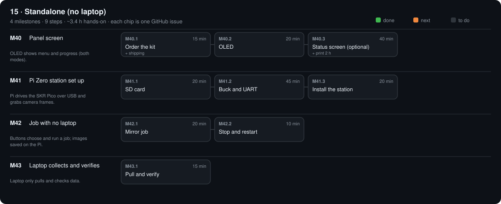

# 15 · Standalone (no laptop)

Optional kit $71.68 (not in the $630 total)

[Design](design.md) · [Parts list](bom.csv) · [3D files](3d/)

## M40 · Panel screen

OLED shows menu and progress (both modes). · 0/3 steps done · ~1.2 h hands-on · ~1 wk

### M40.1 Order the kit

**Time** 15 min (+ shipping) · **Needs** `PARTS.md` → 15 · Standalone

#### Do

1. Tick and order the STA parts you don't have; mark them `ordered`; print `STA-07a_pi_zero_mount.stl`.

#### Verify

- [ ] Stage 15 has no `agreed` or `suggested` parts left.

#### Record

Commit.

### M40.2 OLED

**Time** 20 min · **Needs** STA-05 OLED · STA-06 jumpers

#### Do

1. OLED SDA → ESP32-S3 J3-4 (GPIO 1), SCL → J3-5 (GPIO 2), VIN → 3V3 lever connector (fed from J1-2), GND → sensor GND lever connector (fed from J3-22). With the AS7341 fitted: plug the OLED into the sensor's second STEMMA QT socket instead (README → Wiring → 8).
2. `bash scripts/hub.sh`

#### Verify

- [ ] Screen shows `OpenGonio ready` and the button names.

#### If a check fails

- Blank: address not 0x3C — some boards are 0x3D; change it in `firmware/hub/main.py`.

#### Record

Tick the boxes; `make done id=M40.2`.

### M40.3 Status screen (optional)

**Time** 40 min (+ print 2 h) · **Needs** STA-09 status screen · STA-10 print · FRM-06 M2 screws (4 × 12, 4 × 8) · PWR-20 lever connectors (221-415, 221-413)

#### Do

1. Print `STA-10a_screen_stand` and `STA-10b_screen_bezel`. Before printing, lay the module on the bezel drawing (50 mm window, 4 mm at each short end) and check the display sits inside the window.
2. Module into the stand's pocket, display outward, cable socket through the window behind it; bezel on, 4 × M2 × 8 snug (it presses only the two short ends: stop when the module no longer moves).
3. Stand onto its 4 deck pilots on the NW tile beside the controller tray (M2 × 12), face toward the laptop side; cable out of the open back to the hub.
4. Wire it with the hub add-ons walkthrough (docs/addons.html, README → Wiring → 8): VCC, RST, BL to the 3V3 lever connector; GND to the sensor GND lever connector; CLK J3-6, DIN J3-7, DC J1-11, CS J3-10.
5. `bash scripts/hub.sh send "SCREEN ON"` (the hub restarts), then `bash scripts/hub.sh send "SHOW Bench test|line two"`.

#### Verify

- [ ] Screen shows the status lines, and `Bench test` / `line two` after SHOW.
- [ ] Key presses and power changes appear on the screen within 1 s.

#### If a check fails

- Blank, backlight on: CLK / DIN / DC / CS swapped or `SCREEN ON` not sent. Backlight off: BL or VCC not on 3V3.

#### Record

Tick the boxes; `make done id=M40.3`.

## M41 · Pi Zero station set up

Pi drives the SKR Pico over USB and grabs camera frames. · 0/3 steps done · ~1.4 h hands-on · ~1 wk

### M41.1 SD card

**Time** 20 min · **Needs** STA-01 Pi Zero 2 W · STA-02 microSD · Raspberry Pi Imager

#### Do

1. Imager: Pi OS Lite 64-bit; hostname `opengonio`; SSH on; your WiFi; your user.

#### Verify

- [ ] Pi boots; `ssh <you>@opengonio.local` logs in.

#### Record

Tick the boxes; `make done id=M41.1`.

### M41.2 Buck and UART

**Time** 45 min · **Needs** STA-03 buck · STA-04 OTG adapter · TLS-05 multimeter · cut jumpers

#### Do

1. Buck input: adapter unplugged first. A thin red / black pair under the jack's `+` / `−` screws beside the wires already there (before the e-stop, so the Pi stays on when the motors stop).
2. Set the output **before anything is on it**: nothing on the buck output, adapter in, meter (DC volts) on the output terminals; turn the trim screw until it reads 5.1 V (it can start near 24 V: many turns). Unplug the adapter.
3. A powered USB hub on the Pi's OTG port (STA-04) carries the camera(s) and the SKR Pico's USB-C cable.
4. Wire buck output, UART and hub power per README → Wiring → 9: buck 5.1 V → Pi pin 2, buck − → Pi pin 14; Pi pin 8 (GPIO14 TX) → hub J3-16 (GPIO 48), Pi pin 10 (GPIO15 RX) ← hub J3-17 (GPIO 47), Pi pin 6 → hub J3-1 (GND), Pi pin 4 (5V) → hub J1-21 (5V); never with the hub's USB in the laptop at the same time.
5. Adapter in: the Pi boots. Meter on the buck output terminals: 5.05–5.15 V (the Verify line).

#### Verify

- [ ] Buck output 5.05–5.15 V under the Pi's load.

#### Record

Tick the boxes; `make done id=M41.2`.

### M41.3 Install the station

**Time** 20 min · **Needs** M41.2

#### Do

1. `bash scripts/station.sh <you>@opengonio.local`; then `ssh <you>@opengonio.local sudo reboot`.

#### Verify

- [ ] `ssh <you>@opengonio.local journalctl -u opengonio-station -n 20` shows `station ready`.
- [ ] OLED shows the first job name.

#### Record

Commit.

## M42 · Job with no laptop

Buttons choose and run a job; images saved on the Pi. · 0/2 steps done · ~30 min hands-on · ~1 wk

### M42.1 Mirror job

**Time** 20 min · **Needs** mirror on the table · laptop off

#### Do

1. NEXT until `Mirror check 30`; START.

#### Verify

- [ ] OLED shows `lamp warm-up`, then counts shots, then `done`.

#### Record

Tick the boxes; `make done id=M42.1`.

### M42.2 Stop and restart

**Time** 10 min · **Needs** M42.1

#### Do

1. START a job; STOP midway; START again.

#### Verify

- [ ] `~/opengonio-data/` has an aborted folder (`"aborted": "stopped"`) and a finished one (`"finished": true`).

#### Record

Tick the boxes; `make done id=M42.2`.

## M43 · Laptop collects and verifies

Laptop only pulls and checks data. · 0/1 steps done · ~15 min hands-on · ~1 wk

### M43.1 Pull and verify

**Time** 15 min · **Needs** M42 folders on the Pi

#### Do

1. `opengonio pull <you>@opengonio.local`
2. `opengonio verify data/*`; `opengonio curve data/<mirror job>`

#### Verify

- [ ] Mirror job: `"result": "PASS"`, `mirror_peak_error_deg` within ±0.5; chart peak on the orange line.

#### Record

Verify output in phases/15-standalone/design.md → Results; commit.

[Sources](../../REFERENCES.md): H51 · H52 · H53 · H55 · C7 · L30
