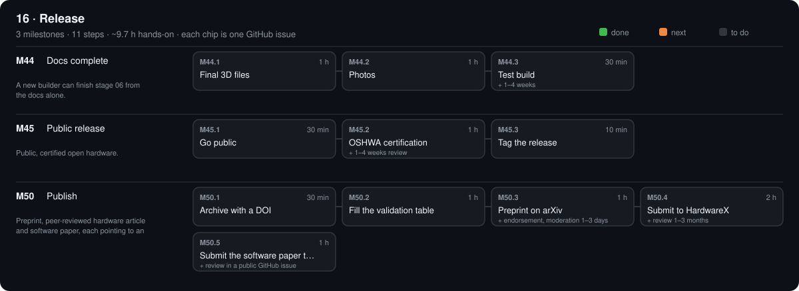

# 16 · Release

[Design](design.md)

## M44 · Docs complete

A new builder can finish stage 06 from the docs alone. · 0/3 steps done · ~2.5 h hands-on · ~2 wk

### M44.1 Final 3D files

**Time** 1 h · **Needs** Onshape

#### Do

1. Export final STEP + STL of every part you changed into its `3d/`; `make all`.

#### Verify

- [ ] `make check` four `OK`; `git status` clean after commit.

#### Record

Commit.

### M44.2 Photos

**Time** 1 h · **Needs** phone

#### Do

1. One photo per finished stage as `phases/NN/photo.jpg`; link it at the top of that `design.md`.

#### Verify

- [ ] Every stage 00–15 has a photo (`ls phases/*/photo.jpg | wc -l` ≥ 16).

#### Record

Commit.

### M44.3 Test build

**Time** 30 min (+ 1–4 weeks) · **Needs** a friend

#### Do

1. Give them the repo link; they build stages 00–06 using only the README and issues.

#### Verify

- [ ] They finish without asking you anything.

#### If a check fails

- Each question they ask = a missing line: add it to that step in `.github/phases.yml`.

#### Record

Their notes in phases/16-release/design.md → Results; commit.

## M45 · Public release

Public, certified open hardware. · 0/3 steps done · ~1.7 h hands-on · ~1 wk

### M45.1 Go public

**Time** 30 min · **Needs** `gh` logged in

#### Do

1. Check `LICENSE` and `LICENSES/`; `gh repo edit --visibility public`; make the Onshape document public.

#### Verify

- [ ] Repo page opens in a private browser window.

#### Record

Tick the boxes; `make done id=M45.1`.

### M45.2 OSHWA certification

**Time** 1 h (+ 1–4 weeks review) · **Needs** certification.oshwa.org account

#### Do

1. Apply with the repo link, licences (CERN-OHL-S-2.0, GPL-3.0-or-later, CC BY-SA 4.0).

#### Verify

- [ ] OSHWA UID issued.

#### Record

UID in the README title line; commit.

### M45.3 Tag the release

**Time** 10 min · **Needs** clean `git status`

#### Do

1. `make release s=16`

#### Verify

- [ ] GitHub → Releases shows `v0.16` with the 3D zip.

## M50 · Publish

Preprint, peer-reviewed hardware article and software paper, each pointing to an archived copy with a DOI. · 0/5 steps done · ~5.5 h hands-on · ~4 wk

### M50.1 Archive with a DOI

**Time** 30 min · **Needs** public repo (M45.1) · zenodo.org account (sign in with GitHub)

#### Do

1. Zenodo → GitHub: switch the repository on; then `make release s=16` (M45.3) makes Zenodo archive that release.
2. Copy the DOI into `paper/submission.yaml` → `archive.zenodo_doi`; set `author.orcid`.

#### Verify

- [ ] `make paper-check`: no "archive DOI" blocker; the specifications table shows the DOI.

#### Record

DOI in `paper/submission.yaml`; commit.

### M50.2 Fill the validation table

**Time** 1 h · **Needs** records of M18.3, M19.1, M20.1, M21.2, M22.1, M22.2, M23.2, M23.3, M24.2, M24.3, M25.4, M26.3, M35.2, M44.3

#### Do

1. For each row of `paper/results.yaml`, copy the measured value from that step's record (design.md → Results). Never type a value that was not measured.
2. Replace the red [TBD]s in `paper/opengonio.tex` (abstract numbers, application figure, acknowledgements, email, AI declaration scope).

#### Verify

- [ ] `make paper-check` prints "Validation: 14 of 14 measured" and no [TBD] blocker.
- [ ] A second reader checks every number in Table 3 against its step record.

#### If a check fails

- A row fails its criterion: report it as measured and say why in "Capabilities and limitations"; do not drop the row.

#### Record

Commit `paper/results.yaml` and `paper/opengonio.tex`.

### M50.3 Preprint on arXiv

**Time** 1 h (+ endorsement, moderation 1–3 days) · **Needs** arXiv account; endorser for physics.ins-det if you have no earlier arXiv paper there

#### Do

1. `make paper-submit`; upload `paper/build/submission/opengonio-source.zip`; category physics.ins-det (cross-list cs.GR).

#### Verify

- [ ] arXiv's compiled PDF matches `paper/build/submission/opengonio-hardwarex.pdf` (references resolved, tables present).

#### Record

arXiv ID in phases/16-release/design.md → Results; commit.

### M50.4 Submit to HardwareX

**Time** 2 h (+ review 1–3 months) · **Needs** Editorial Manager account (HardwareX)

#### Do

1. Re-read the current HardwareX guide for authors against `paper/submission.yaml`; update it if the guide changed.
2. Upload `opengonio-source.zip` (LaTeX) with `opengonio-hardwarex.pdf` and `graphical_abstract.png` from `paper/build/submission/`; give the Zenodo DOI where the form asks for data/code availability.

#### Verify

- [ ] Submission confirmation e-mail with a manuscript number.

#### If a check fails

- Desk rejection for missing validation: finish M50.2 rows the editor names, then resubmit.

#### Record

Manuscript number and dates in phases/16-release/design.md → Results; commit.

### M50.5 Submit the software paper to JOSS

**Time** 1 h (+ review in a public GitHub issue) · **Needs** real measurements published (M50.2) for the research impact statement

#### Do

1. Write the "Research impact statement" in `paper/joss/paper.md` from real results; preview it (command printed by `make paper-submit`).
2. Submit at joss.theoj.org with the repository URL and the Zenodo DOI.

#### Verify

- [ ] `make paper-check`: no joss blocker; JOSS opens a pre-review issue.

#### Record

JOSS review issue link in phases/16-release/design.md → Results; commit.

[Sources](../../REFERENCES.md): T50 · T51 · N50 · H31 · H32 · H33 · H34 · H35 · H36 · H45
