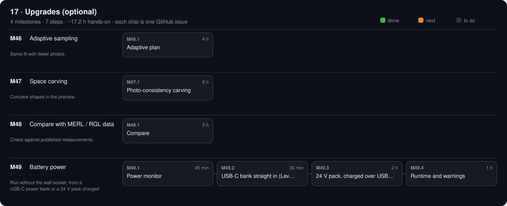

# 17 · Upgrades (optional)

[Design](design.md)

## M46 · Adaptive sampling

Same fit with fewer photos. · 0/1 steps done · ~4 h hands-on

### M46.1 Adaptive plan

**Time** 4 h · **Needs** Python · simulator

#### Do

1. New `software/src/opengonio/plans/adaptive.py`: start at a 30° isotropic grid; add poses between neighbours whose `brdf_per_sr` differ > 20 % [R15]; repeat until none.
2. Test with `--sim plastic`: compare with the 15° full grid.

#### Verify

- [ ] Fit within 2 % of the full-grid fit with ≥ 3 × fewer shots; `make test` passes.

#### Record

Shot counts + fits in phases/17-upgrades/design.md → Results.

## M47 · Space carving

Concave shapes in the preview. · 0/1 steps done · ~6 h hands-on

### M47.1 Photo-consistency carving

**Time** 6 h · **Needs** Python · M34 hull

#### Do

1. Extend `scan/carve.py`: after the hull, remove surface voxels whose colour disagrees across the views that see them [S7].

#### Verify

- [ ] A printed bowl: concave depth recovered within 2 mm (S4-style test in `make test`).

#### Record

Result in design.md.

## M48 · Compare with MERL / RGL data

Check against published measurements. · 0/1 steps done · ~3 h hands-on

### M48.1 Compare

**Time** 3 h · **Needs** a material that exists in MERL or RGL [R13][R16]

#### Do

1. Measure it (`capture isotropic`); `opengonio fit`.
2. Fit the published data with the same model (`opengonio.fit.fit`).

#### Verify

- [ ] Fitted roughness within 20 % of the published fit.

#### Record

Both fits + a plot in `phases/17-upgrades/`.

## M49 · Battery power

Run without the wall socket, from a USB-C power bank or a 24 V pack charged over USB-C. · 0/4 steps done · ~4.2 h hands-on · ~1 wk

### M49.1 Power monitor

**Time** 45 min · **Needs** stage 01 power and the ESP32-S3 hub working · INA219 (BAT-05) + STEMMA QT cable (BAT-05b)

#### Do

1. Power off: adapter unplugged. Move the red lead that runs from the jack `+` to the e-stop: jack `+` → INA219 `VIN+`, INA219 `VIN−` → e-stop (lever connector). Now it reads every source.
2. Chain it on the hub's first I²C pair: hub → AS7341 (SPC-02) → INA219 (BAT-05b) → OLED. Female jumper from a hub GND pin to the 24 V `−` lever connector (the INA219 reads bus volts against the hub ground).
3. `bash scripts/hub.sh` (copies the new firmware); `python -m serial.tools.miniterm /dev/ttyACM1 115200` (the hub's port); type `SOURCE WALL`, then `BATT?`.

#### Verify

- [ ] `BATT WALL` reads 24.0 ± 0.3 V, about 0.03 A with the motors asleep, `OK` (design.md → Battery power).

#### Record

Idle and homing volts and amps in phases/17-upgrades/design.md → Results.

### M49.2 USB-C bank straight in (Level 1)

**Time** 30 min · **Needs** M49.1 · PD trigger (BAT-02), plug lead (BAT-06), a USB-C bank with a 20 V profile, ≥ 45 W

#### Do

1. Set the trigger's DIP switch to 20 V; plug in the bank; its display must read 20 V (not 5 V).
2. Plug lead into the trigger's screw terminals: red `+`, black `−`. Meter on the plug (T-B1): centre `+`, 20.0 V.
3. E-stop pressed. Adapter out, plug lead into the jack, then release the e-stop. Send `SOURCE USBC <bank Wh>` (the Wh printed on the bank).

#### Verify

- [ ] Home, then one mirror sweep finishes; `BATT USBC` reads 19.5–20.5 V throughout.

#### Record

Bank model, Wh, and the sweep's Wh used in design.md → Results.

### M49.3 24 V pack, charged over USB-C (Level 2)

**Time** 2 h · **Needs** M49.2 · pack (BAT-01), charging module (BAT-03), fuse holder + fuse (BAT-04)

#### Do

1. Pack on arrival (T-B2): 21–25.2 V on its leads; read its label for the protections; note balancing and a thermistor if listed.
2. Charging module, pack **not** connected: trigger out → module in; set output 24.00 V and current limit 1.000 A (its manual); check the LCD (T-B3).
3. Fuse holder on the pack `+`. Lever connectors: node `+` = fuse lead + module out `+` + plug lead `+`; node `−` = pack `−` + module out `−` + plug lead `−`. Never use the pack's own 25.2 V charger.
4. Charge until the module's current falls below 0.1 A at 24.0 V. Then e-stop pressed, plug lead into the jack, release. Send `SOURCE PACK`.

#### Verify

- [ ] Charging stops at 24.0 V (T-B3); `BATT PACK` reads 23.8–24.1 V full; a mirror sweep runs with USB-C both plugged in and unplugged.

#### Record

Charge time from empty, pack volts full and after one sweep, in design.md → Results.

### M49.4 Runtime and warnings

**Time** 1 h · **Needs** M49.3

#### Do

1. T-B4: from full, run mirror sweeps back to back (USB-C unplugged) until the OLED shows CRIT.
2. T-B5: check that CRIT appeared on the OLED and in the app log, and that the run paused after its pose.

#### Verify

- [ ] CRIT at 20.3–20.5 V; the run paused; hours and Wh replace the estimates in design.md.

#### Record

Hours, Wh used and the volts curve (from `BATT?` every minute) in design.md → Results.

[Sources](../../REFERENCES.md): R15 · G11 · G13 · G15 · G31 · G32 · G46 · G47 · G48 · G51 · T3 · T6 · T7 · T16 · T18 · T23 · T24 · T27 · T28 · T29 · T33 · V6 · V32 · V34 · N5 · N11 · N39 · H12
