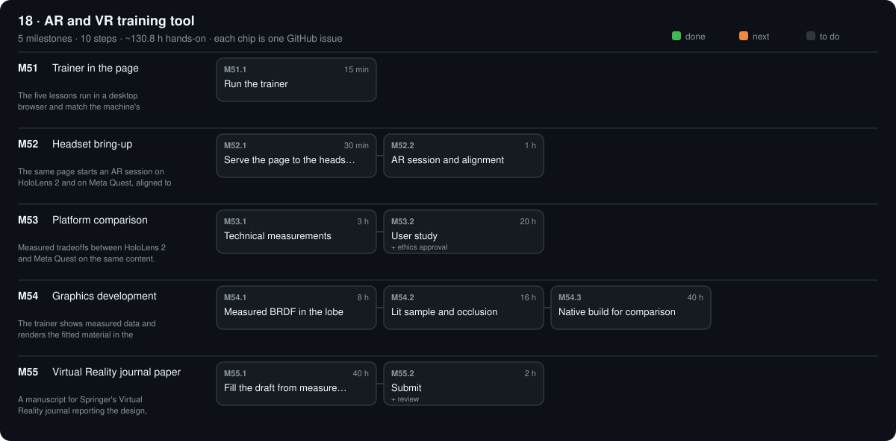

# 18 · AR and VR training tool

[Design](design.md) · [3D files](3d/)

## M51 · Trainer in the page

The five lessons run in a desktop browser and match the machine's kinematics and BRDF model. · 0/1 steps done · ~15 min hands-on

### M51.1 Run the trainer

**Time** 15 min · **Needs** laptop, browser · Node.js (for the test)

#### Do

1. Open `docs/xr.html` (or the website → AR and VR). Step through lessons 1–5; move M4, M3, M2, M1 and the roughness.
2. `make test` (runs `software/tests/test_xr.py`: the page's JavaScript against `fit.py` and `kinematics.py`).

#### Verify

- [ ] Lesson 1: the M4 arc is solid from 20° to 324° and red across the gap at the camera.
- [ ] Lesson 3 at M3 = 45°, M2 = 0°, M4 = 90°: θi = θr = 45°, camera 0° off the mirror direction.
- [ ] `make test` passes with test_xr not skipped.

#### If a check fails

- Blank view: the browser has no WebGL; try another browser.
- test_xr skipped: install Node.js.

#### Record

Browser and version in phases/18-xr-training/design.md → Results; commit.

## M52 · Headset bring-up

The same page starts an AR session on HoloLens 2 and on Meta Quest, aligned to the real machine. · 0/2 steps done · ~1.5 h hands-on · ~1 wk

### M52.1 Serve the page to the headsets

**Time** 30 min · **Needs** HoloLens 2 and Meta Quest on the lab network (lab equipment, not in the parts list) · website published (HTTPS), or `opengonio app --lan`

#### Do

1. WebXR needs HTTPS: open the published website's `xr.html` in each headset's browser (Edge on HoloLens 2, Browser on Quest).
2. Note for each headset: operating system version, browser version, whether Enter AR and Enter VR are enabled.

#### Verify

- [ ] Both headsets load the page and show the 3D view.

#### If a check fails

- Enter AR greyed on HoloLens 2: record the Edge version; this is a known risk [X6]. Go to M54.3 (native build).

#### Record

Versions and button states in phases/18-xr-training/design.md → Results; commit.

### M52.2 AR session and alignment

**Time** 1 h · **Needs** machine built to stage 06 (arm, table, camera in place) · e-stop pressed: nothing moves during training

#### Do

1. Enter AR. Pinch at the centre of the sample, then at the camera lens.
2. Step through the five lessons with a pinch. End the session; press Download log.
3. Repeat three times per headset, from a different standing position each time.

#### Verify

- [ ] Log `alignment.residual_mm` within ± 15 mm on all three runs (design target, not yet measured).
- [ ] The red stops of the M4 arc sit at the 20° and 324° marks of the ring scale, by eye, within one scale division.

#### If a check fails

- Overlay tilted: the bench is not level, or the second pinch was not at the lens.
- No log: the session was closed by taking the headset off; end it from the menu.

#### Record

The six JSON logs in `phases/18-xr-training/logs/`; residuals in phases/18-xr-training/design.md → Results; commit.

## M53 · Platform comparison

Measured tradeoffs between HoloLens 2 and Meta Quest on the same content. · 0/2 steps done · ~23 h hands-on · ~3 wk

### M53.1 Technical measurements

**Time** 3 h · **Needs** logs of M52.2 · ruler, the ring scale on the machine

#### Do

1. From the logs: frames per second, 95th percentile frame time, late frames, per headset and per mode (AR, VR).
2. Drift: align, walk once round the bench, measure the overlay's offset at the 20° stop with a ruler. Five repeats per headset.
3. Field of view: standing 0.75 m from the zero point, the fraction of the M4 arc visible without moving the head.
4. Legibility: rate the arcs and rays 1–5 with the lab lights on and the lamp on, then lights off.

#### Verify

- [ ] Every row of the protocol table (wiki → XR training) has a measured value with its number of repeats, or is marked not measurable with the reason.

#### If a check fails

- A row cannot be measured on one headset: report that as the result; do not estimate.

#### Record

Table in phases/18-xr-training/design.md → Results and `paper/xr/results.yaml`; commit.

### M53.2 User study

**Time** 20 h (+ ethics approval) · **Needs** Institutional Review Board approval, consent forms · participants: students who have not used the machine

#### Do

1. Within-subject or between-subject design, fixed before recruiting and written in `paper/xr/protocol.md`.
2. Each participant: pre-quiz, training on one headset, post-quiz, System Usability Scale [X9], NASA Task Load Index [X10], Simulator Sickness Questionnaire [X11].
3. Control condition: the same lessons in the page on a laptop.

#### Verify

- [ ] Approval number recorded before the first session.
- [ ] Anonymised data file with one row per participant; analysis script reproduces every reported number.

#### If a check fails

- No approval yet: do M53.1 and M54 first; never collect participant data without it.

#### Record

Anonymised data and script in `phases/18-xr-training/study/`; summary in phases/18-xr-training/design.md → Results; commit.

## M54 · Graphics development

The trainer shows measured data and renders the fitted material in the headset. · 0/3 steps done · ~64 h hands-on · ~3 wk

### M54.1 Measured BRDF in the lobe

**Time** 8 h · **Needs** a real `curve.csv` (stage 07)

#### Do

1. Load a run's `curve.csv` and `fit.json` in the page; draw the measured points on the lobe next to the fitted surface.

#### Verify

- [ ] Points lie on the lobe where the holdout error is low; `make test` passes.

#### If a check fails

- Points far off the lobe everywhere: check the angle convention against `kinematics.py`.

#### Record

Screenshot and run name in phases/18-xr-training/design.md → Results; commit.

### M54.2 Lit sample and occlusion

**Time** 16 h · **Needs** M52.2 passed

#### Do

1. Draw the sample disc lit with the fitted material (shader of `docs/og/render-gl.js`) under the virtual lamp.
2. Occlusion: render the CAD model depth-only before the overlay in AR, so real parts hide lines behind them.

#### Verify

- [ ] A line passing behind the table post disappears behind it in the headset.
- [ ] Frame rate stays within 10 % of M53.1.

#### If a check fails

- Occlusion edges swim: alignment error; repeat M52.2.

#### Record

Before and after frame times in phases/18-xr-training/design.md → Results; commit.

### M54.3 Native build for comparison

**Time** 40 h · **Needs** Unity with the Mixed Reality Toolkit 3 (HoloLens 2) and the Meta XR SDK (Quest), or one OpenXR build for both

#### Do

1. Export the machine as `.glb` (already produced by `make cad`). Port the five lessons; keep the same geometry constants and BRDF formula.
2. Log the same frame-time summary as the page.

#### Verify

- [ ] The native build shows the same θi, θr and BRDF value as the page for three poses.

#### If a check fails

- Values differ: the engine is left-handed, y up; check the axis conversion.

#### Record

Build settings and the comparison in phases/18-xr-training/design.md → Results; commit.

## M55 · Virtual Reality journal paper

A manuscript for Springer's Virtual Reality journal reporting the design, the implementation and the measured comparison. · 0/2 steps done · ~42 h hands-on · ~4 wk

### M55.1 Fill the draft from measured results

**Time** 40 h · **Needs** M53.1 done; M53.2 done or explicitly out of scope · `paper/xr/opengonio-xr.tex`

#### Do

1. Replace every [TBD] in `paper/xr/opengonio-xr.tex` with a value from `paper/xr/results.yaml`. Never type a value that was not measured.
2. Move the text into the Springer Nature LaTeX template; figures to the journal's rules (wiki → XR training → Journal rules).

#### Verify

- [ ] `grep -c TBD paper/xr/opengonio-xr.tex` prints 0.
- [ ] Abstract 150–250 words; 4–6 keywords; Declarations section complete.

#### If a check fails

- A result is missing: report the gap in Limitations; do not fill it.

#### Record

Commit the manuscript and `paper/xr/results.yaml`.

### M55.2 Submit

**Time** 2 h (+ review) · **Needs** all authors agree on the text and the author order · use of AI tools described in Methods, as the journal requires

#### Do

1. Re-read the journal's current submission guidelines; submit the editable source files with the PDF.

#### Verify

- [ ] Submission confirmation with a manuscript number.

#### If a check fails

- Returned as incomplete: a declaration is missing; add it and resubmit.

#### Record

Manuscript number and date in phases/18-xr-training/design.md → Results; commit.

[Sources](../../REFERENCES.md): X6
