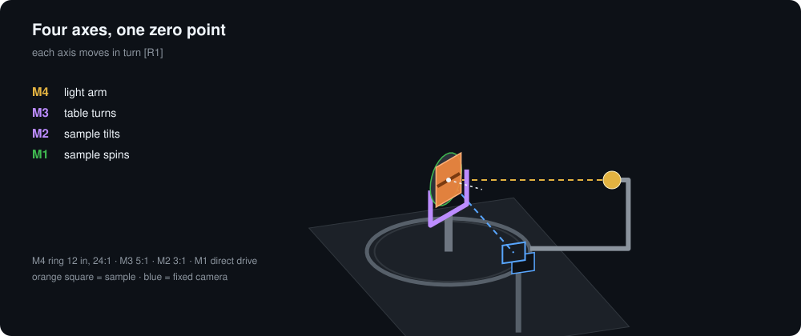

<!-- generated from wiki/src/Machine.md by tools/refs_bib.py - edit the source -->

# The machine

| Axis | Moves                       | Range   | Drive                                        | Step (1/16) | Built in |
|------|-----------------------------|---------|----------------------------------------------|-------------|----------|
| M4   | light arm around the sample | 20–324° | GT2 belt on 12 in ring, 24:1                 | 0.0047°     | stage 04 |
| M3   | table (sample yaw)          | ±180°   | 20T → 100T, 5:1                              | 0.0225°     | stage 05 |
| M2   | sample tilt (yoke)          | ±90°    | 20T → 60T, 3:1 (1/32)                        | 0.0188°     | stage 08 |
| M1   | sample spin (platter)       | ±180°   | direct drive (pancake motor), 1/64 microstep | 0.028°      | stage 09 |

Measuring camera fixed on +X at 350 mm; scan camera fixed at 650 mm, 15° up, looking over it, so no camera ever moves or refocuses (one-camera option: move it, \$81 cheaper). Light 300 mm from the zero point. Optical homing on every axis, one over-travel switch in the e-stop loop (light arm, at 17°; the other ends rely on soft limits and the e-stop), 30 mm keep-out and 5° minimum light–camera angle (Ansari-Asl et al., 2024).

**Why the light is on a side ring.** Reflectance depends only on the light and camera directions *relative to the sample*, and the table (M3) and tilt (M2) already turn the sample to every direction an overhead light could reach. A horizontal ring keeps the arm’s weight on the bearing (the motor only moves it), stays low and stiff, and keeps cables out of the light path. A light on the camera axis (coaxial, via a beam splitter) sees only back-scatter, not the mirror peak, and loses ~75 % of the light in the splitter; it stays a possible later add-on for retroreflective materials.

### Two sensors, two jobs

|          | Camera (IMX477, fixed, 350 mm)                                | Spectral sensor (AS7341, above the camera)                       |
|----------|---------------------------------------------------------------|------------------------------------------------------------------|
| Measures | images: brightness per pixel, 3 colours                       | 8 visible bands 415–680 nm + clear + NIR (10 readings), one spot |
| Used for | angles (mirror test), textures (SVBRDF), 3D scan, calibration | colour spectrum vs angle (spectral BRDF)                         |
| Command  | `opengonio capture …`                                         | `opengonio capture … --spectral` (or `--no-camera`)              |
| Stage    | 06                                                            | 10 (optional, +\$17)                                             |

## References

Ansari-Asl, M., Barbieri, M., Obein, G., & Hardeberg, J. Y. (2024). Optical and electromechanical design and implementation of an advanced multispectral device to capture material appearance. *Journal of Imaging*, *10*(3), 55. <https://doi.org/10.3390/jimaging10030055>
